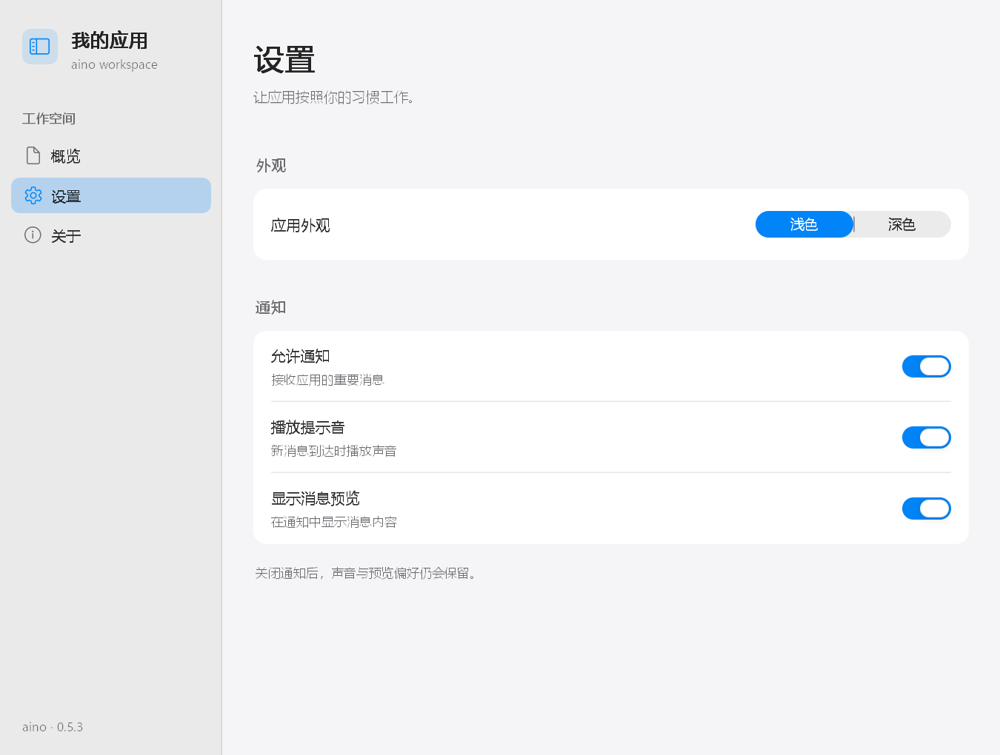
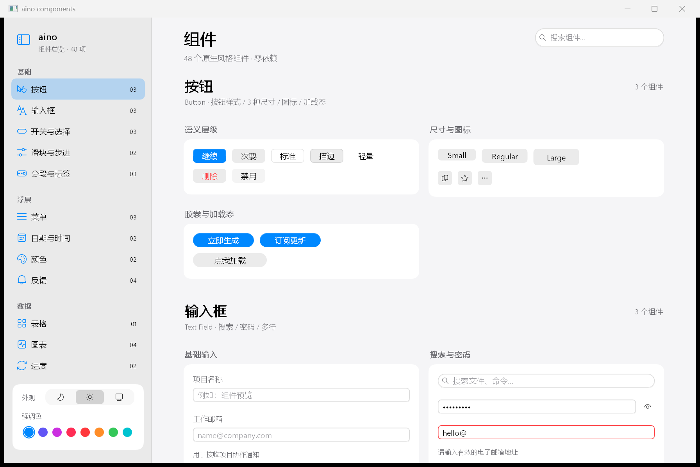
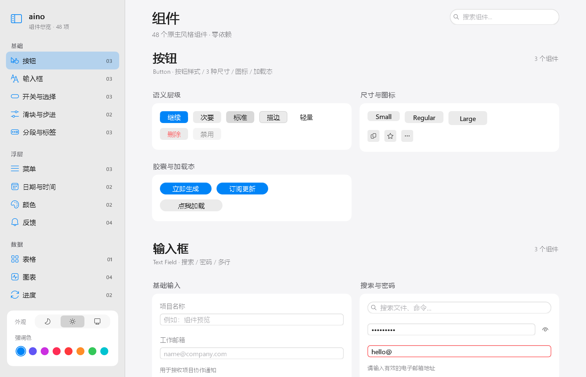
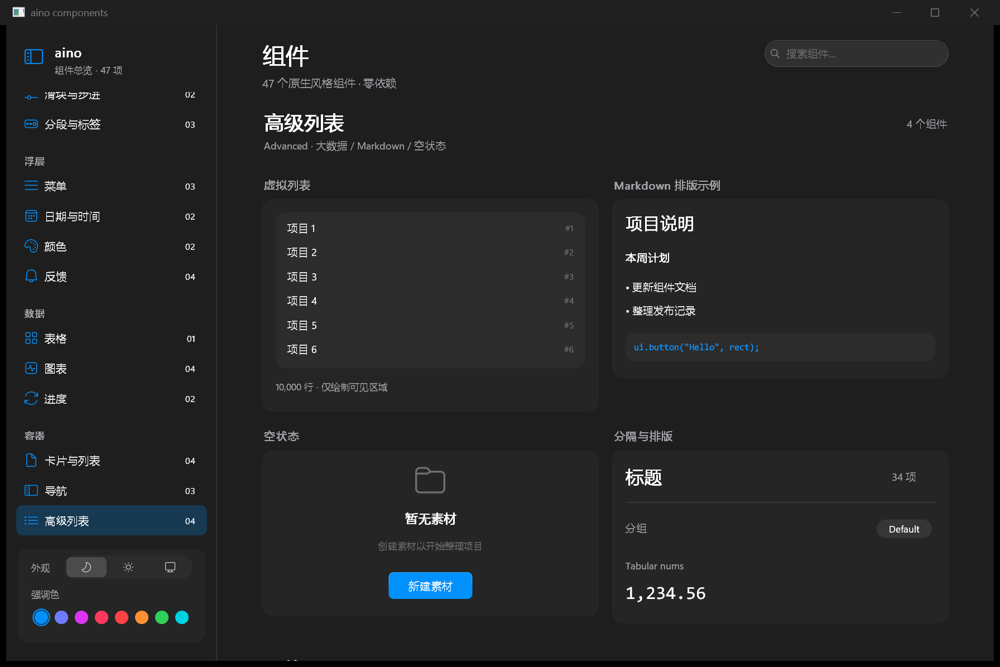
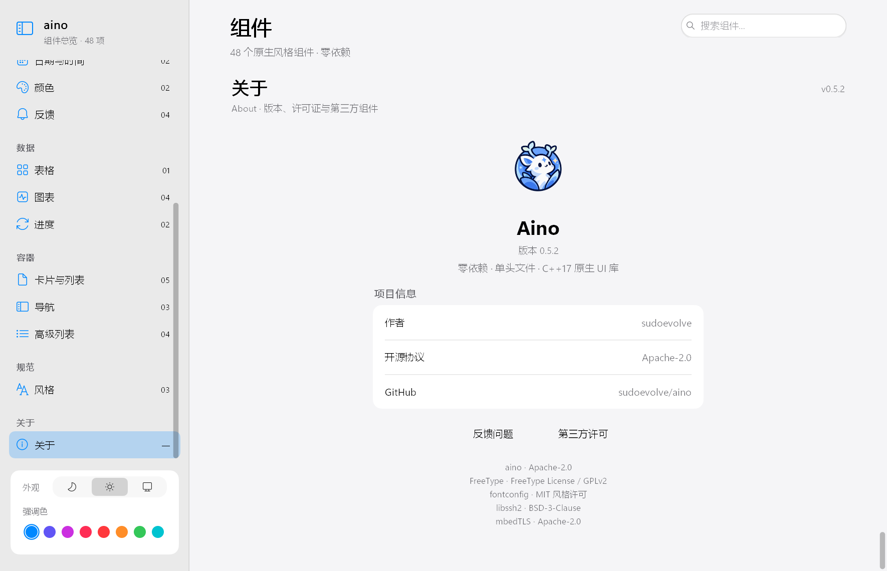
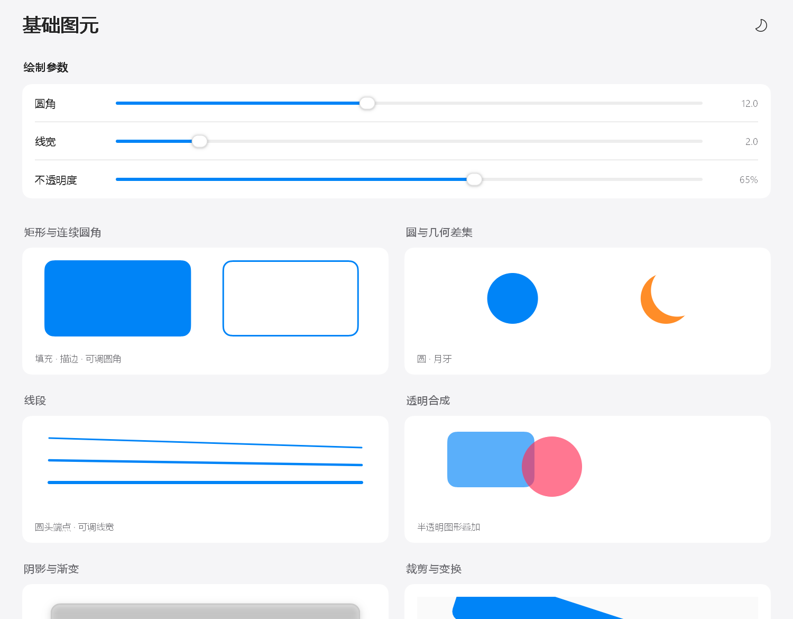
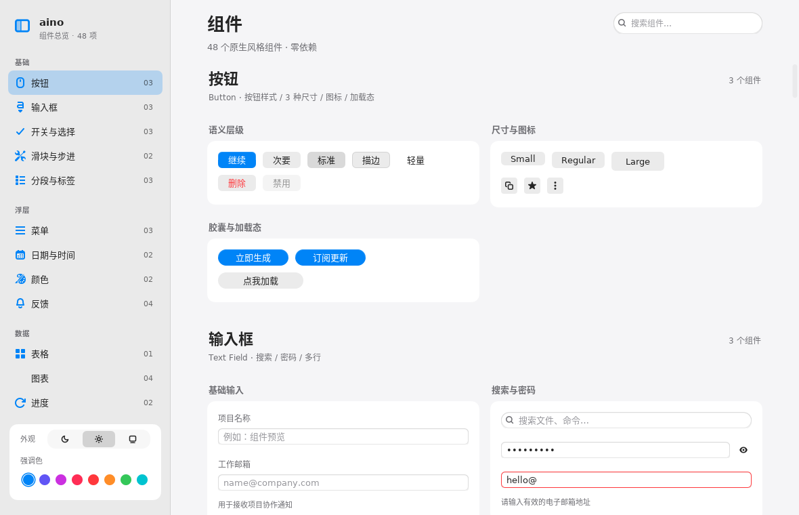
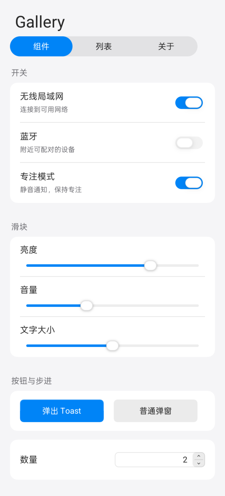
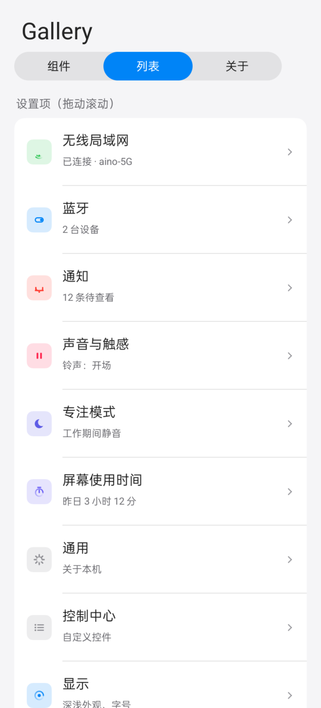

<div align="center">
  
  <h1>aino</h1>
  <p><strong>跨平台 C++17 桌面 UI 库</strong></p>
  <p>单头文件 · 立即模式 · CPU 光栅化 · 事件驱动 · 空闲时阻塞等待</p>
  <p>
    <a href="#quick-start">快速开始</a> ·
    <a href="#features">特性</a> ·
    <a href="#docs">文档</a> ·
    <a href="https://sudoevolve.github.io/aino/">官网与 Wiki</a> ·
    <a href="LICENSE">Apache-2.0</a>
  </p>
</div>

aino 以原生桌面体验和低空闲开销为目标。核心库集中在 `aino.hpp`，直接使用各平台窗口、
字体与系统接口，不依赖第三方 UI 框架。界面采用 macOS 风格，背景材质以 CPU 模糊近似。

## Screenshots

以下为 Windows 示例实窗截图。

<table>
  <tr>
    <td align="center"><strong>分组设置</strong><br></td>
    <td align="center"><strong>组件画廊</strong><br></td>
    <td align="center"><strong>按钮与输入控件</strong><br></td>
  </tr>
  <tr>
    <td align="center"><strong>深色外观</strong><br></td>
    <td align="center"><strong>关于页面</strong><br></td>
    <td align="center"><strong>基础图元</strong><br></td>
  </tr>
</table>

Linux 原生 Wayland 组件画廊（实际 CPU 内容画布）：



## Features

- **单头文件**：核心实现位于 `aino.hpp`，C++17，无第三方 UI 依赖。
- **事件驱动**：无事件时阻塞等待；仅在需要时重绘，空闲时 CPU 占用接近 0。
- **CPU 光栅化**：自绘几何、图像和材质效果，配合系统字体与窗口后端。
- **原生平台后端**：Windows GDI、macOS Cocoa、Linux X11 / Wayland、Android NativeActivity（实验性）。
- **完整组件集**：布局、主题、输入控件、表格、图表、浮层与动画等。
- **图像支持**：PNG、JPEG、BMP 与 GIF 首帧，可加载后复用并绘制。

## 开发规范

界面以 iOS／macOS 设置应用为视觉参考：

- 按功能分组，同组条目放进一张圆角卡片；分组标题置于卡片外。
- 使用系统字体、清晰的标题与说明层级、主题配色，兼容深浅外观。
- 卡片默认圆角 12、左右内边距 16、设置项行高 64；标题和说明在左，控件居中贴右，分隔线缩进。
- 内容区居中并限制宽度，窄窗口调整布局；文字完整显示，卡片底部留足间距，长内容可滚动。
- 样式直接写在各示例内，保留交互与状态；修改后检查深浅主题、最小窗口及 DPI，并同步更新预览截图。

详细尺寸与参考示例见 [AGENTS.md](AGENTS.md)。

## Quick Start

Requirements:

- C++17 编译器：MSVC 19.29+、GCC 12+ 或 Clang 14+
- 核心 UI 无第三方开发依赖，不要求构建系统或资源文件；系统运行库说明见下文

`main.cpp`：

```cpp
#define AINO_IMPLEMENTATION          // 只能出现在一个编译单元里
#include "aino.hpp"

#include <string>

int main() {
    aino::Window win(aino::WindowConfig{880, 560, "aino 示例"});
    if (!win.ok()) return 1;

    std::string email;
    bool notify = true;

    win.run([&](aino::Ui& ui) {
        ui.panel({24, 24, 400, 240});
        aino::Stack col = ui.vbox({24, 24, 400, 240}, 10.0f, 18.0f);
        ui.heading("设置", col.next(34.0f), aino::Style().left());
        ui.input(&email, col.next(24.0f), aino::Style().hint("you@example.com"));
        ui.checkbox(&notify, "邮件通知", col.next(22.0f));
        if (ui.button("保存", col.next(24.0f), aino::Style().primary())) {
            win.set_title("设置已保存");
        }
    });
    return 0;
}
```

Build：

```sh
# MSVC（/utf-8 必须加，否则中文字面量按 GBK 编；/MT = 静态链 CRT，目标机不用装运行库）
cl /std:c++17 /utf-8 /EHsc /O2 /MT main.cpp user32.lib gdi32.lib ole32.lib windowscodecs.lib

# MinGW（-static = 静态链接编译器运行时）
g++ -std=c++17 -O2 -mwindows -s -static main.cpp -o app.exe -lgdi32 -luser32 -lole32 -lwindowscodecs

# GCC / X11
g++ -std=c++17 -O2 main.cpp -o app -lX11 -ldl
```

`-static` 需要工具链提供完整静态运行时；不能全静态链接时，可使用
`-static-libgcc -static-libstdc++` 并按导入表随附所需的 `libwinpthread-1.dll`。
MSVC 的 `/MT` 静态链接 CRT；应用仍使用平台系统 DLL。

Run：

```sh
./app.exe
```

仓库里自带的 gallery 示例：

```sh
cmake -S . -B build -DCMAKE_BUILD_TYPE=Release
cmake --build build --config Release
./build/Release/aino_gallery.exe  # Visual Studio；Ninja/Makefiles 使用 ./build/aino_gallery
```

CMake 自动扫描 `examples/*.cpp`，每个文件生成 `aino_<文件名>`；
新增或删除顶层示例源码后，构建会触发重新配置；Visual Studio 可能需重新加载后再构建一次。
也可先执行 `cmake -S . -B build` 更新目标。`.hpp` 不生成程序。
Visual Studio 产物在 `build/Release/`，Ninja/Makefiles 通常在 `build/`。

```sh
cmake --build build --config Release --target aino_primitives_demo
```

`ssh_client.cpp` 的构建目标为 `aino_ssh`，需额外安装 libssh2（MSVC 使用预编译 libssh2 + mbedTLS）。
默认关闭，`-DAINO_BUILD_SSH=ON` 显式启用并检查依赖；详见 [构建说明](docs/wiki/01-quickstart.md)。

`win.run(frame_cb)` 管理主循环，窗口按需重绘；动画与后台数据更新方式见
[快速开始](docs/wiki/01-quickstart.md)。

图片可使用 `aino::Image` 加载一次，再通过 `ui.draw_image(image, box)` 绘制；
支持 PNG、JPEG、BMP 和 GIF 首帧。Linux 运行时需要 GdkPixbuf。
可通过 `WindowConfig::icon_path` 自定义窗口图标；Windows 示例将默认 ICO 和 Gallery 图片嵌入可执行文件。
macOS Finder 图标需要 `.app` 和 `.icns`；Linux 桌面图标需要 `.desktop` 入口，
仅设置窗口图标不会改变文件管理器显示的图标。非 Windows 示例仍需旁置 PNG。详见 [图元文档](docs/wiki/09-primitives.md)。

原生后端：Windows（GDI）、Linux（X11 / Wayland）、macOS（Cocoa）和 Android（NativeActivity，实验性）。
Linux 默认使用 X11；`-DAINO_WAYLAND=ON` 构建纯 Wayland，直接以共享内存呈现 CPU 像素，
不依赖 XWayland 或 GPU。[Wayland 接入](docs/wiki/15-wayland.md)说明运行库、输入法和桌面标识。
不同桌面的系统互通、输入法与混合 DPI 多屏仍需分别验收，详见
[平台能力矩阵](docs/wiki/14-platform-status.md)。

### Android（实验性）

|  |  |
|---|---|
| 组件页（OPPO 真机，Android 16） | 触摸滚动列表 |

Android 后端通过 NativeActivity 直接渲染 CPU 像素：文字 = 系统的 `AFontMatcher` 选字 +
FreeType 光栅化（构建时由 CMake 下载官方源码包，SHA256 校验，不入仓库；离线环境用
`-DAINO_FREETYPE_DIR` 指向本地解压目录），触摸按"单指=鼠标、拖动=滚轮"映射，
转屏由 manifest 拦截 configChanges（Ui 状态原地保留），空闲 0% CPU。
本期边界：无软键盘（IME 需 Java 参与）、无剪贴板/图像解码/颜色 emoji；
BACK 键交给系统退出应用。方案与取舍见 [Android 适配分析](docs/design/16-android-port.md)。

```sh
# 真机构建（需要 Android SDK + NDK 26+；无 Gradle，脚本自动 aapt2/签名）
python3 android/build_apk.py --install        # 构建 adb 安装
python3 android/build_apk.py --launch         # 安装并启动
# 产物：android/build/aino-gallery.apk（minSdk 29，arm64-v8a）
# 首次配置联网下载 FreeType；离线构建：cmake -DAINO_FREETYPE_DIR=<解压目录>

# 桌面预览：examples/mobile_gallery.cpp 双端同源，桌面开手机比例窗口调样式
cmake --build build --target aino_mobile_gallery
```

## Project Layout

```text
aino.hpp                     核心库
examples/gallery.cpp         组件画廊
examples/mobile_gallery.cpp  移动端画廊（Android 与桌面预览双入口）
examples/sidebar_demo.cpp    侧栏导航与设置
examples/pomodoro.cpp        番茄钟
examples/primitives_demo.cpp 基础图元
examples/function_viewer.cpp 函数可视化
examples/ssh_client.cpp      SSH/SFTP 客户端（可选依赖）
android/                     Android 打包工程（NativeActivity，无 Gradle；
                             FreeType 构建时下载，不入仓库）
docs/wiki/                   正式教程与 API
docs/reviews/                工程审查与历史记录
docs/design/                 设计研究
site/                        官网与 Markdown Wiki 阅读器
screenshots/                 预览截图
tools/                       构建、测试与性能检查
CMakeLists.txt               示例构建配置
```

日常开发只编译受影响目标；发布验收使用 `python tools/regress.py`，完整检查加 `--full`；
工具说明见 [开发工具](tools/README.md)。

## Docs

[正式 Wiki 索引](docs/wiki/README.md) · [在线 Wiki](https://sudoevolve.github.io/aino/?page=README.md) · [网站预览与发布](site/README.md) · [工程审查记录](docs/reviews/README.md)

- [01 快速开始](docs/wiki/01-quickstart.md)
- [02 样式与主题](docs/wiki/02-style-and-theme.md)
- [03 布局](docs/wiki/03-layout.md)
- [04 文本类组件](docs/wiki/04-text.md)
- [05 容器类组件](docs/wiki/05-containers.md)
- [06 交互类组件](docs/wiki/06-interactive.md)
- [07 展示类组件](docs/wiki/07-display.md)
- [08 浮层类组件](docs/wiki/08-overlays.md)
- [09 图元与度量](docs/wiki/09-primitives.md)
- [10 逐组件性能实测（历史基准）](docs/wiki/10-performance.md)
- [11 动画与变换](docs/wiki/11-motion.md)
- [12 组件与示例索引](docs/wiki/12-component-index.md)
- [15 原生 Wayland](docs/wiki/15-wayland.md)
- [文档索引](docs/README.md)

## License

Copyright © 2026 sudoevolve（[sudoevolve@gmail.com](mailto:sudoevolve@gmail.com)）

[Apache License 2.0](LICENSE)。可以商用、修改、再分发，保留版权与许可声明即可。
