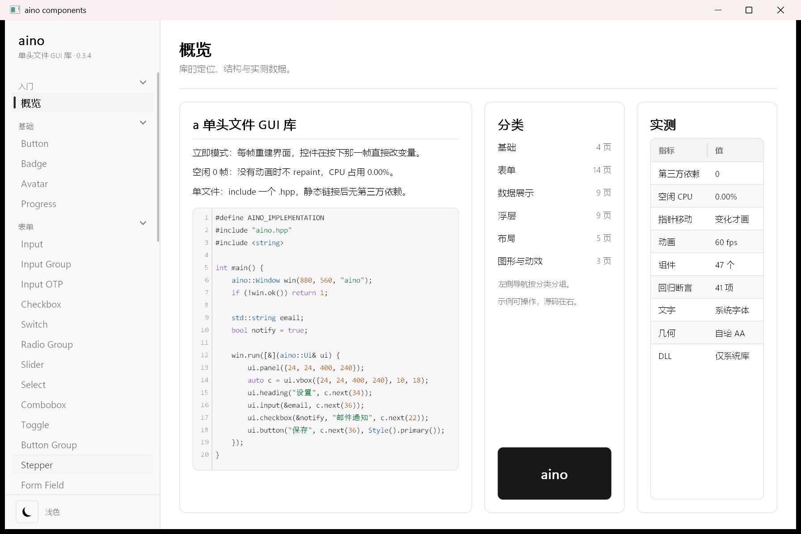
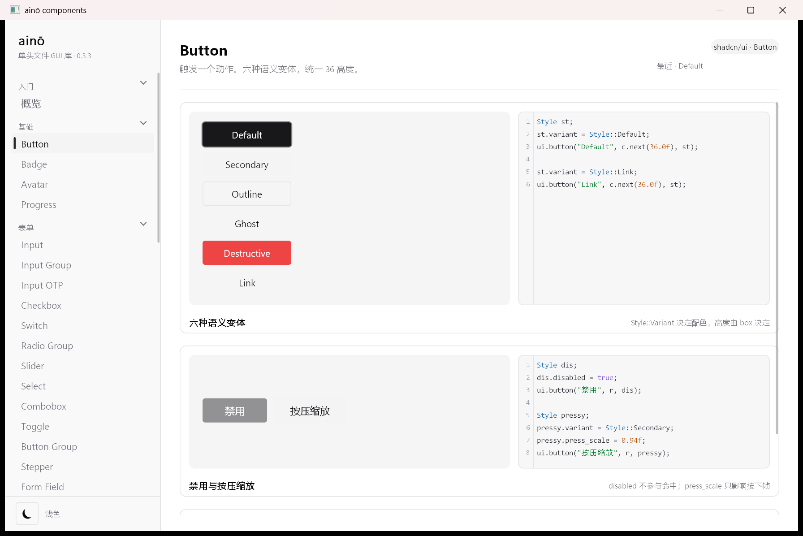
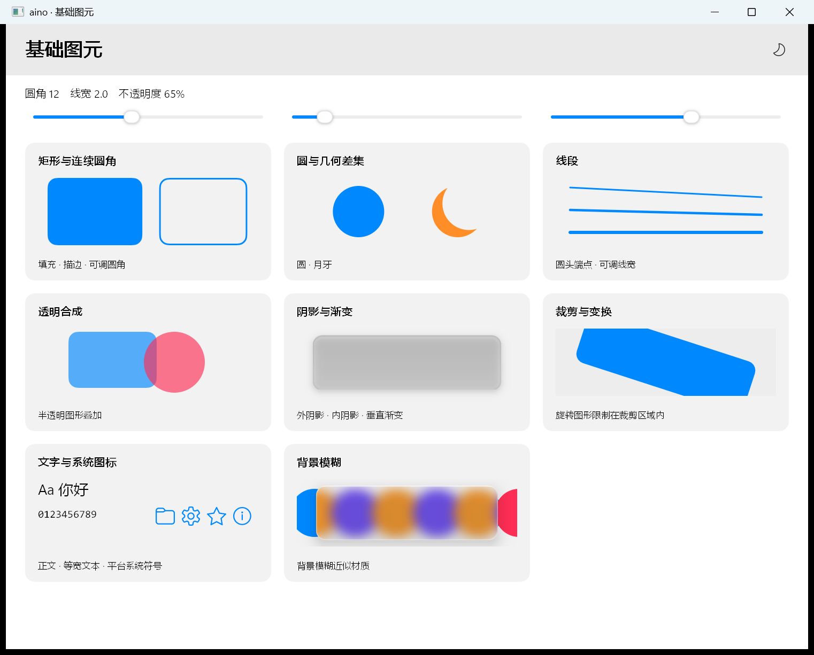

# aino

单头文件 C++17 桌面 UI 库 —— 立即模式、零第三方依赖、空闲 0.00% CPU。（这是一个纯vibo coding项目）

核心库只有一个 `aino.hpp`，使用系统绘制和字体接口，无第三方 UI 或图标依赖。采用 macOS 风格，背景材质以模糊近似。

## Preview

|                                                     |                                               |
| --------------------------------------------------- | --------------------------------------------- |
|  |  |
|            |          |



## Quick Start

Requirements:

- C++17 编译器：MSVC 19.29+、GCC 12+ 或 Clang 14+
- 核心 UI 无第三方开发依赖，不要求构建系统或资源文件；系统运行库说明见下文

`main.cpp`：

```cpp
#define AINO_IMPLEMENTATION          // 只能出现在一个编译单元里
#include "aino.hpp"

#include <string>

int main() {
    aino::Window win(880, 560, "aino 示例");
    if (!win.ok()) return 1;

    std::string email;
    bool notify = true;

    win.run([&](aino::Ui& ui) {
        ui.panel({24, 24, 400, 240});
        aino::Stack col = ui.vbox({24, 24, 400, 240}, 10.0f, 18.0f);
        ui.heading("设置", col.next(34.0f), aino::Style().left());
        ui.input(&email, col.next(24.0f), aino::Style().hint("you@example.com"));
        ui.checkbox(&notify, "邮件通知", col.next(22.0f));
        if (ui.button("保存", col.next(24.0f), aino::Style().primary())) {
            win.set_title("设置已保存");
        }
    });
    return 0;
}
```

Build：

```sh
# MSVC（/utf-8 必须加，否则中文字面量按 GBK 编；/MT = 静态链 CRT，目标机不用装运行库）
cl /std:c++17 /utf-8 /EHsc /O2 /MT main.cpp user32.lib gdi32.lib

# MinGW（-static = 静态链接编译器运行时）
g++ -std=c++17 -O2 -mwindows -s -static main.cpp -o app.exe -lgdi32 -luser32

# GCC / X11
g++ -std=c++17 -O2 main.cpp -o app -lX11 -ldl
```

`-static` 需要工具链提供完整静态运行时；不能全静态链接时，可使用
`-static-libgcc -static-libstdc++` 并按导入表随附所需的 `libwinpthread-1.dll`。
MSVC 的 `/MT` 静态链接 CRT；应用仍使用平台系统 DLL。

Run：

```sh
./app.exe
```

仓库里自带的 gallery 示例：

```sh
cmake -S . -B build -DCMAKE_BUILD_TYPE=Release
cmake --build build --config Release
./build/Release/aino_gallery.exe  # Visual Studio；Ninja/Makefiles 使用 ./build/aino_gallery
```

CMake 自动扫描 `examples/*.cpp`，每个文件生成 `aino_<文件名>`；
新增或删除顶层示例源码后，构建会触发重新配置；Visual Studio 可能需重新加载后再构建一次。
也可先执行 `cmake -S . -B build` 更新目标。`.hpp` 不生成程序。
Visual Studio 产物在 `build/Release/`，Ninja/Makefiles 通常在 `build/`。

```sh
cmake --build build --config Release --target aino_primitives_demo
```

`ssh_client.cpp` 保留兼容目标名 `aino_ssh`，需额外安装 libssh2（MSVC 使用预编译 libssh2 + mbedTLS）。
缺依赖仅跳过此目标，`-DAINO_BUILD_SSH=OFF` 可禁用；详见 [构建说明](docs/01-quickstart.md)。

画廊“空状态”卡片中的“新建素材”会打开独立窗口，填写名称与说明后回填主窗口。
`tools/child_window.py` 验证点击、创建、取消以及两个消息循环的响应。

Windows 每个窗口线程使用独立帧定时器，多窗口实测不等于 Cocoa 支持后台线程建窗。

`win.run(frame_cb)` 就是完整主循环：没事件时阻塞在 `WaitMessage`，帧回调只在需要重绘时被调用 —— 窗口静止时 0 帧 / 0.00% CPU，不是低帧率空转。

Windows 本地回归覆盖组件状态、滚动布局、编辑、19 项整窗行为、空闲 CPU 与多窗口。
仓库 CI 仅在发布 GitHub Release（含预发布版本）时自动运行，也可在 Actions 页面手动触发。
普通提交、分支推送、PR 和单独推送 tag 不触发自动 CI。
CI 在 Windows/Linux/macOS 上编译、开窗冒烟并运行几何像素断言；
当前 mac 风格尚未完成 Linux/macOS 真机核对。输入、IME、剪贴板与 Cocoa 多窗口的限制见
[平台支持](docs/README.md#平台支持)。

X11 字体回退先检查 Fontconfig 字符覆盖集合再打开字体，避免缺字加载无关字体文件；字体顺序、字号和 metrics 保持原有规则。Linux 系统图标读取桌面图标主题，使用系统 GdkPixbuf/SVG loader，不初始化 GTK；运行依赖与返回约定见 [系统图标](docs/09-primitives.md#5-文字与系统图标)。这批资源路径修复尚未在 Ubuntu 实机复测，未运行本轮回归。

## Project Layout

```text
aino.hpp             库本体，单文件（全部实现都在这一个头里）
examples/gallery.cpp 15 分类、43 示例卡片（固定侧栏与工具栏、连续滚动）
examples/sidebar_demo.cpp 侧边栏切换（新手第一个 demo）
examples/pomodoro.cpp 番茄钟（侧栏、工具栏、倒计时与时长设置）
examples/primitives_demo.cpp 基础图元、裁剪、变换与背景模糊
examples/function_viewer.cpp 函数可视化、自定义表达式、采样缓存与手动播放
examples/ssh_client.cpp 可选 SSH/SFTP 客户端、后台传输与取消（额外依赖见上文）
docs/                文档，01 快速开始 … 12 组件与示例索引
screenshots/         预览截图
tools/               构建、像素断言与回归脚本
tools/regress.py     默认核心交互检查，--only 指定探针，--full 完整检查
tools/perf_gallery.py 实际画廊空闲、移动、滚动、拖动与悬停 CPU 采样
tools/shot_pages.py  按分类截整窗图（改完版式先看一眼，不算回归）
tools/ci_smoke.cpp   CI 冒烟程序：开窗 + 跑满 20 帧就退（三平台共用）
tools/ci_pixels.cpp  跨平台像素断言：44 项（含 4 项 X11 专有），直接读后备缓冲（三平台共用）
tools/probe/         数值/像素探针（回归用，不参与发布）
CMakeLists.txt       自动为 examples/*.cpp 创建可执行目标，SSH 可选
```

日常修改运行 `python tools/regress.py --only macos_gallery_probe` 等相关探针，
已有最新产物可加 `--no-build`；完整检查使用 `--full`，性能单独运行 `python tools/perf_gallery.py`。

## 输入法兼容修复（未发布）

Windows 输入框会同步隐藏系统 caret 和 IMR_QUERYCHARPOSITION 的屏幕位置，供系统候选框定位；WM_IME_COMPOSITION 从 lParam 读取提交标志，不将组字标志误当 HIMC。原生模态消息重入时延后未完成帧的绘制。

后续候选框修复移除了按 `MSCTFIME Composition` 类名隐藏/透明化原生 IME 窗口及其 20 ms 计时器。内联组合串只通过 WM_IME_SETCONTEXT 的 ISC_SHOWUICOMPOSITIONWINDOW 标志处理，候选显示标志保留；组合位置不再依赖隐藏窗口高度。系统窗口的可见性、样式与透明度由输入法拥有，库不干预。既有 ime_comp_probe 同步覆盖该约束并修正模拟消息的 lParam 标志；MSVC 已编译通过，按调用方要求未执行探针，仍需真实 Windows 输入法确认候选框显示。

X11/XWayland 协商 XIMPreeditPosition 并更新物理光标坐标，合并 XNFilterEvents，支持较长 UTF-8 提交和输入框焦点切换；不支持该样式时回退原有 XIMPreeditNothing。不改变应用现有字体或布局，不代表原生 Wayland 输入法协议支持。

这批修改按调用方要求只做必要编译和代码审查，Windows MSVC 的 capture_probe 已编译通过，未执行新的探针或回归；真实候选窗口位置和 Linux 桌面输入法仍需实际环境验证。

## Docs

- [01 快速开始](docs/01-quickstart.md)
- [02 样式与主题](docs/02-style-and-theme.md)
- [03 布局](docs/03-layout.md)
- [04 文本类组件](docs/04-text.md)
- [05 容器类组件](docs/05-containers.md)
- [06 交互类组件](docs/06-interactive.md)
- [07 展示类组件](docs/07-display.md)
- [08 浮层类组件](docs/08-overlays.md)
- [09 图元与度量](docs/09-primitives.md)
- [10 逐组件性能实测（历史基准）](docs/10-performance.md)
- [11 动画与变换](docs/11-motion.md)
- [12 组件与示例索引](docs/12-component-index.md)
- [文档索引](docs/README.md)

## License

Copyright © 2026 sudoevolve（[sudoevolve@gmail.com](mailto:sudoevolve@gmail.com)）

[Apache License 2.0](LICENSE)。可以商用、修改、再分发，保留版权与许可声明即可。
