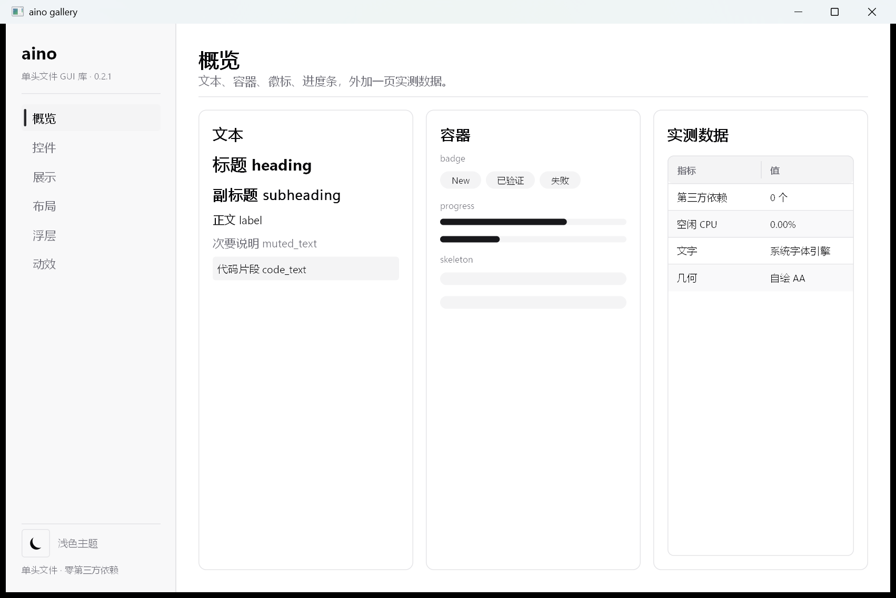
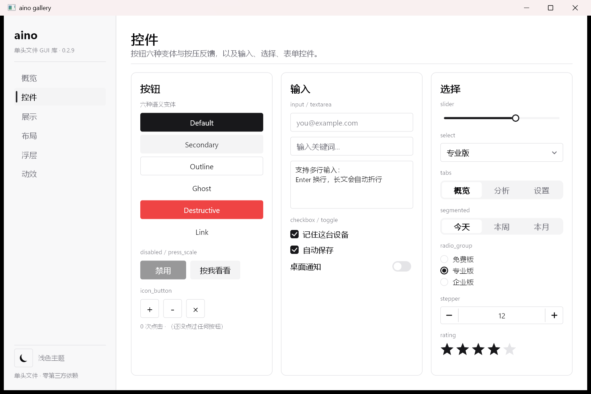
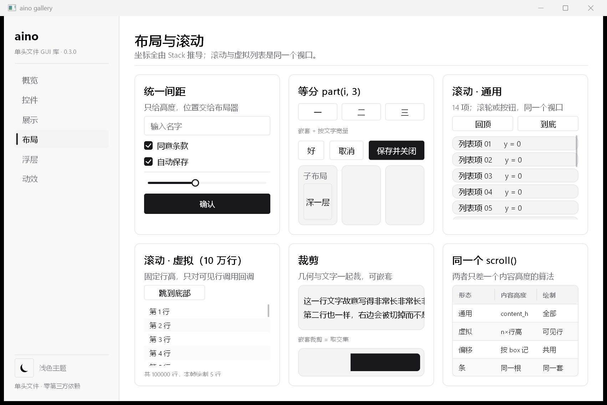
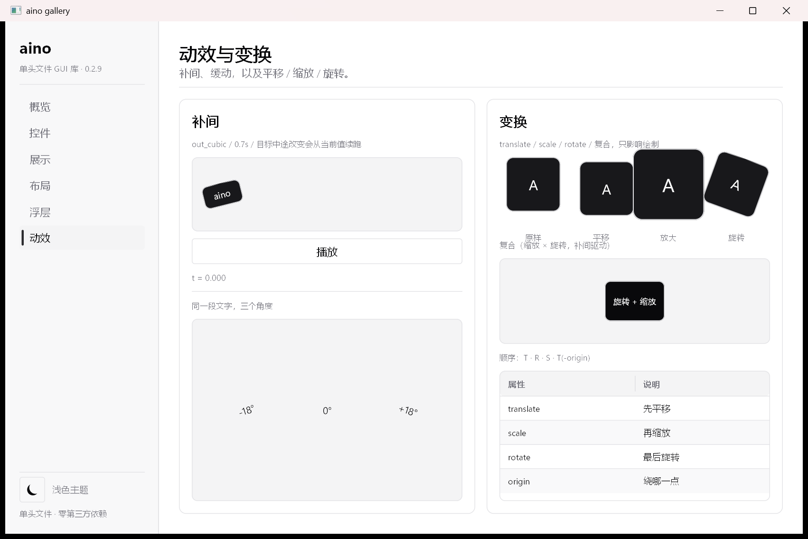
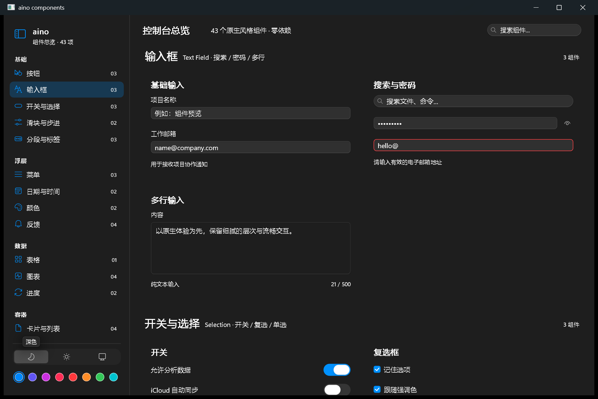
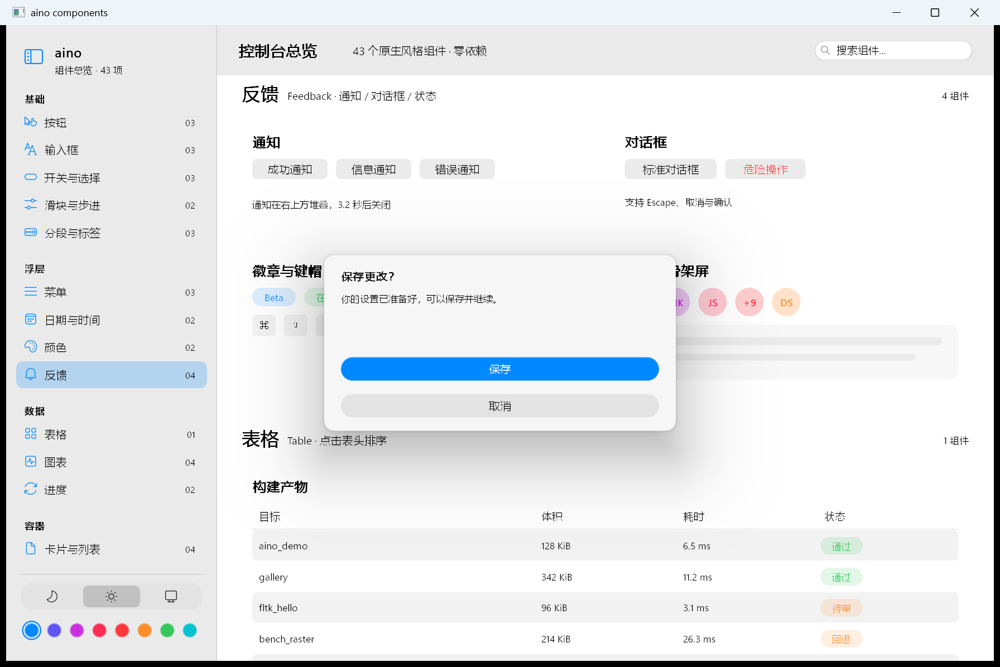

# aino

单头文件 C++17 桌面 UI 库 —— 立即模式、零第三方依赖、空闲 0.00% CPU。

一个 `aino.hpp`（7263 行 / 327.9 KiB），一个 exe 482 KiB，零 DLL 依赖（只用系统 DLL）。

## Preview

|  |  |
| --- | --- |
|  |  |
|  |  |
|  |  |

## Quick Start

Requirements:

- C++17 编译器：MSVC 19.29+、GCC 12+ 或 Clang 14+
- 没有其它依赖，不需要构建系统、资源文件或额外 DLL

`main.cpp`：

```cpp
#define AINO_IMPLEMENTATION          // 只能出现在一个编译单元里
#include "aino.hpp"

#include <string>

int main() {
    aino::Window win(880, 560, "aino 示例");
    if (!win.ok()) return 1;

    std::string email;
    bool notify = true;

    win.run([&](aino::Ui& ui) {
        ui.panel({24, 24, 400, 240});
        aino::Stack col = ui.vbox({24, 24, 400, 240}, 10.0f, 18.0f);
        ui.heading("设置", col.next(34.0f), aino::Style().left());
        ui.input(&email, col.next(36.0f), aino::Style().hint("you@example.com"));
        ui.checkbox(&notify, "邮件通知", col.next(22.0f));
        if (ui.button("保存", col.next(36.0f), aino::Style().primary())) {
            // 点到了
        }
    });
    return 0;
}
```

Build：

```sh
# MSVC（/utf-8 必须加，否则中文字面量按 GBK 编；/MT = 静态链 CRT，目标机不用装运行库）
cl /std:c++17 /utf-8 /EHsc /O2 /MT main.cpp user32.lib gdi32.lib

# MinGW（-static = 静态链运行时，产物一个 DLL 都不带）
g++ -std=c++17 -O2 -mwindows -s -static main.cpp -o app.exe -lgdi32 -luser32

# GCC / X11
g++ -std=c++17 -O2 main.cpp -o app -lX11
```

`-static` 要求工具链的静态运行时完整：CLion 自带的那套 MinGW 15.2.0 链接不过
（缺 `__intrinsic_setjmpex`），换 w64devkit / MSYS2 即可；坚持用它就只能退回
`-static-libgcc -static-libstdc++` 并随附一个 `libwinpthread-1.dll`。MSVC 用 `/MT` 则零 DLL。

Run：

```sh
./app.exe
```

仓库里自带的 gallery 示例：

```sh
cmake -S . -B build -DCMAKE_BUILD_TYPE=Release
cmake --build build --config Release
./build/aino_gallery.exe
```

`win.run(frame_cb)` 就是完整主循环：没事件时阻塞在 `WaitMessage`，帧回调只在需要重绘时被调用 —— 窗口静止时 0 帧 / 0.00% CPU，不是低帧率空转。

平台状态：Windows 后端已验证；X11 与 macOS 后端代码已写但**未验证**。

## Project Layout

```text
aino.hpp             库本体，单文件（全部实现都在这一个头里）
examples/gallery.cpp 唯一示例：6 页组件画廊（按域分页）
docs/                文档，01 快速开始 … 11 动画与变换
screenshots/         预览截图
tools/               构建、像素断言与回归脚本
tools/probe/         数值/像素探针（回归用，不参与发布）
CMakeLists.txt       构建 gallery
```

改完跑一遍 `python tools/regress.py`（编译 + 探针 + 像素断言 + 空闲 CPU），全绿再提交。

## Docs

- [01 快速开始](docs/01-quickstart.md)
- [02 样式与主题](docs/02-style-and-theme.md)
- [03 布局](docs/03-layout.md)
- [04 文本类组件](docs/04-text.md)
- [05 容器类组件](docs/05-containers.md)
- [06 交互类组件](docs/06-interactive.md)
- [07 展示类组件](docs/07-display.md)
- [08 浮层类组件](docs/08-overlays.md)
- [09 图元与度量](docs/09-primitives.md)
- [10 逐组件性能实测](docs/10-performance.md)
- [11 动画与变换](docs/11-motion.md)
- [文档索引](docs/README.md)

## License

Copyright © 2026 sudoevolve（[sudoevolve@gmail.com](mailto:sudoevolve@gmail.com)）

[Apache License 2.0](LICENSE)。可以商用、修改、再分发，保留版权与许可声明即可。
