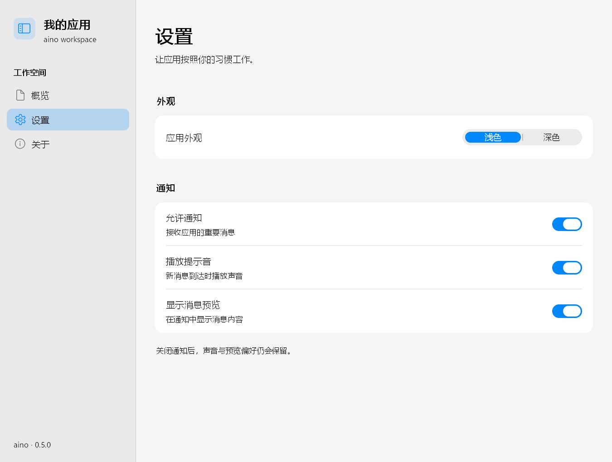

# aino

单头文件 C++17 桌面 UI 库，采用立即模式与事件驱动主循环。定位是跨平台极低占用

核心库只有一个 `aino.hpp`，使用系统绘制和字体接口，无第三方 UI 或图标依赖。采用 macOS 风格，背景材质以模糊近似。

## Preview

以下为 Windows 上的示例实窗截图，界面采用 iOS／macOS 风格。

| 分组设置                                          | 组件画廊                                            |
| ------------------------------------------------- | --------------------------------------------------- |
|        |  |
|  |            |
|          |              |

## 开发规范

界面以 iOS／macOS 设置应用为视觉参考：

- 按功能分组，同组条目放进一张圆角卡片；分组标题置于卡片外。
- 使用系统字体、清晰的标题与说明层级、主题配色，兼容深浅外观。
- 卡片默认圆角 12、左右内边距 16、设置项行高 64；标题和说明在左，控件居中贴右，分隔线缩进。
- 内容区居中并限制宽度，窄窗口调整布局；文字完整显示，卡片底部留足间距，长内容可滚动。
- 样式直接写在各示例内，保留交互与状态；修改后检查深浅主题、最小窗口及 DPI，并同步更新预览截图。

详细尺寸与参考示例见 [AGENTS.md](AGENTS.md)。

## Quick Start

Requirements:

- C++17 编译器：MSVC 19.29+、GCC 12+ 或 Clang 14+
- 核心 UI 无第三方开发依赖，不要求构建系统或资源文件；系统运行库说明见下文

`main.cpp`：

```cpp
#define AINO_IMPLEMENTATION          // 只能出现在一个编译单元里
#include "aino.hpp"

#include <string>

int main() {
    aino::Window win(880, 560, "aino 示例");
    if (!win.ok()) return 1;

    std::string email;
    bool notify = true;

    win.run([&](aino::Ui& ui) {
        ui.panel({24, 24, 400, 240});
        aino::Stack col = ui.vbox({24, 24, 400, 240}, 10.0f, 18.0f);
        ui.heading("设置", col.next(34.0f), aino::Style().left());
        ui.input(&email, col.next(24.0f), aino::Style().hint("you@example.com"));
        ui.checkbox(&notify, "邮件通知", col.next(22.0f));
        if (ui.button("保存", col.next(24.0f), aino::Style().primary())) {
            win.set_title("设置已保存");
        }
    });
    return 0;
}
```

Build：

```sh
# MSVC（/utf-8 必须加，否则中文字面量按 GBK 编；/MT = 静态链 CRT，目标机不用装运行库）
cl /std:c++17 /utf-8 /EHsc /O2 /MT main.cpp user32.lib gdi32.lib

# MinGW（-static = 静态链接编译器运行时）
g++ -std=c++17 -O2 -mwindows -s -static main.cpp -o app.exe -lgdi32 -luser32

# GCC / X11
g++ -std=c++17 -O2 main.cpp -o app -lX11 -ldl
```

`-static` 需要工具链提供完整静态运行时；不能全静态链接时，可使用
`-static-libgcc -static-libstdc++` 并按导入表随附所需的 `libwinpthread-1.dll`。
MSVC 的 `/MT` 静态链接 CRT；应用仍使用平台系统 DLL。

Run：

```sh
./app.exe
```

仓库里自带的 gallery 示例：

```sh
cmake -S . -B build -DCMAKE_BUILD_TYPE=Release
cmake --build build --config Release
./build/Release/aino_gallery.exe  # Visual Studio；Ninja/Makefiles 使用 ./build/aino_gallery
```

CMake 自动扫描 `examples/*.cpp`，每个文件生成 `aino_<文件名>`；
新增或删除顶层示例源码后，构建会触发重新配置；Visual Studio 可能需重新加载后再构建一次。
也可先执行 `cmake -S . -B build` 更新目标。`.hpp` 不生成程序。
Visual Studio 产物在 `build/Release/`，Ninja/Makefiles 通常在 `build/`。

```sh
cmake --build build --config Release --target aino_primitives_demo
```

`ssh_client.cpp` 保留兼容目标名 `aino_ssh`，需额外安装 libssh2（MSVC 使用预编译 libssh2 + mbedTLS）。
缺依赖仅跳过此目标，`-DAINO_BUILD_SSH=OFF` 可禁用；详见 [构建说明](docs/01-quickstart.md)。

`win.run(frame_cb)` 管理主循环，窗口按需重绘；动画与后台数据更新方式见
[快速开始](docs/01-quickstart.md)。

支持 Windows（GDI）、Linux（X11）和 macOS（Cocoa）。Wayland 会话通过 XWayland 运行，
目前没有原生 Wayland 后端。平台限制见 [平台支持](docs/README.md#平台支持)。

## Project Layout

```text
aino.hpp                     核心库
examples/gallery.cpp         组件画廊
examples/sidebar_demo.cpp    侧栏导航与设置
examples/pomodoro.cpp        番茄钟
examples/primitives_demo.cpp 基础图元
examples/function_viewer.cpp 函数可视化
examples/ssh_client.cpp      SSH/SFTP 客户端（可选依赖）
docs/                        使用文档
screenshots/                 预览截图
tools/                       构建、测试与性能检查
CMakeLists.txt               示例构建配置
```

开发检查使用 `python tools/regress.py`，完整检查加 `--full`；
工具说明见 [回归与截图](docs/README.md#回归与截图)。

## Docs

- [01 快速开始](docs/01-quickstart.md)
- [02 样式与主题](docs/02-style-and-theme.md)
- [03 布局](docs/03-layout.md)
- [04 文本类组件](docs/04-text.md)
- [05 容器类组件](docs/05-containers.md)
- [06 交互类组件](docs/06-interactive.md)
- [07 展示类组件](docs/07-display.md)
- [08 浮层类组件](docs/08-overlays.md)
- [09 图元与度量](docs/09-primitives.md)
- [10 逐组件性能实测（历史基准）](docs/10-performance.md)
- [11 动画与变换](docs/11-motion.md)
- [12 组件与示例索引](docs/12-component-index.md)
- [文档索引](docs/README.md)

## License

Copyright © 2026 sudoevolve（[sudoevolve@gmail.com](mailto:sudoevolve@gmail.com)）

[Apache License 2.0](LICENSE)。可以商用、修改、再分发，保留版权与许可声明即可。
