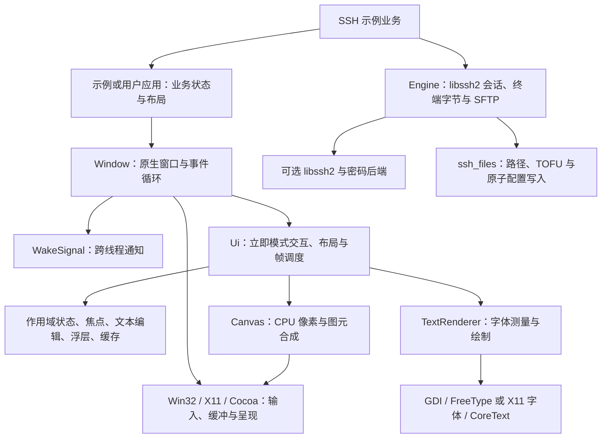

# 全项目工程审查（2026-11-18）

审查基线：`83115225267c5d72b3d0ca5db60435bf8626d51d`。本文第 0～10 节是该版本的审查快照，不代表后续版本仍有相同问题；后续实施状态见第 11 节。源码位置均相对此基线，行号便于查找，函数名用于后续追踪。

结论：**单头文件、CPU 光栅化、立即模式与按需绘制的总体方向合理，当前不需要推翻架构。优先工作是防止数据丢失、约束外部输入、补齐平台契约，再降低 SSH 和 Cocoa 的空闲唤醒及阻塞。** Windows 的实现和验证最充分；X11 有真实后端但部分系统集成缺失；Cocoa 距离同等功能和低功耗目标还有明显距离。macOS 风格外观与原生 macOS 后端成熟度必须分开评价。

## 0. 范围、证据与验证边界

- 检查 Git 跟踪的 149 个文件的目录、职责与工程入口，重点阅读 `aino.hpp`、六个示例、SSH 支持头、CMake、工作流、探针注册、构建/性能/开发服务器脚本及文档。仓库包含 71 个 C++ 源/头文件、21 个 Python 文件，其中 `tools/probe/` 下有 60 个 `.cpp`；这些数量不等于已执行测试或覆盖率。
- 证据分为 **确定问题**（实现中存在明确错误路径，未必本轮动态复现）、**潜在风险**（依赖具体输入、时序或平台行为）、**优化建议**（正确性未发现错误，成本有改进空间）。严重程度与证据强度分别标注。
- 遵循 `AGENTS.md`，本轮不是发布验证，**未运行 CTest、回归探针、批量验证脚本或性能基准**。未运行远程 SSH、未进行破坏性输入实验、未声称已获得新的 CPU/延迟/内存实测数据。
- 在 Windows 使用 MSVC 19.51.36247.0、Windows SDK 10.0.26100，新建被忽略的 `build/audit-20261118`，禁用测试后编译 `aino_gallery`、`aino_function_viewer`，均通过且未输出编译警告；再开启 SSH、保持 `AINO_STATIC_EXE=OFF` 编译 `aino_ssh`，通过但出现 `LNK4098`，见 M10。
- 未在 Linux/macOS 原生运行，也未进行界面外观修改；因此没有本轮跨平台截图或界面验收结论。第三方密码库没有做完整 CVE、供应链或密码学审计。
- 本次仅增加报告及文档索引，未修复或重构运行代码。较大变更以下述方案为评审依据，避免把审查和行为修改混成一次提交。
- 对照 `docs/reviews/13-project-review.md`、`14-platform-status.md`、`15-audit-2026-11-14.md` 的历史记录，已落地的阴影掩膜缓存、等宽测量纳入布局、状态作用域释放、Windows 代理对处理等，不重新列为未修复问题。

## 1. 整体架构与工程定位

### 1.1 调用关系与职责

`aino.hpp` 约 1.49 万行，公开声明在前，`AINO_IMPLEMENTATION` 后包含实现。`Window` 拥有后端、`Ui`、画布、文字渲染器及唤醒资源；`Ui::Impl` 管理持久交互状态，使用作用域和稳定身份区分拥有者；绘制通过 CPU 图元及平台文字实现写入缓冲，再由原生 API 呈现。输入、布局、绘制在帧回调内汇合。

SSH 是可选应用，`ssh_client.cpp` 承担界面与会话协调，`ssh_core.hpp` 包含 Engine 和终端，`ssh_files.hpp` 隔离本地文件支持。核心不依赖 SSH，依赖方向基本正确。应用线程通过 `wake()` 通知 UI，而不直接从后台绘制，这个边界应保留。

### 1.2 值得保留的优势

1. 单头文件分发与“一处定义实现”的接入契约简单，并已有跨编译单元链接探针。
2. CPU 渲染对设置工具、连接管理器、小型桌面应用有明确价值；现有几何、阴影、图标等价探针有助于在优化时保住视觉正确性。
3. Windows/X11 已具备通知与重绘时限机制；空闲阻塞、交互才绘制是正确的性能基础。番茄钟使用 `steady_clock` 和条件变量，函数图像已有采样缓存，均不应退回逐帧重复计算。
4. `state_scope()` / `release_state_scope()` 区分隐藏与永久销毁，较简单的全局控件字典更有明确生命周期；缓存预算、撤销预算和状态探针已存在。
5. 示例采用文件内布局，符合仓库要求；没有理由为统一外观引入额外跨示例样式框架。

### 1.3 真正的架构问题

- **后端契约没有统一落实。** 同名 API 在不同平台可能实际无效；剪贴板、键盘、缩放、关闭等基本能力不能仅靠“编译成功”表明支持。
- **时间概念混合。** 有界动画增量、真实经过时间、业务到期时间分散处理，导致编辑合并和消息超时行为不稳定。
- **SSH 的串行化粒度不合理。** 会话锁保护了 libssh2，但锁内含阻塞网络调用、等待及较长传输循环，线程数量增加并没有隔离终端和传输的延迟。
- **资源预算不统一。** 部分缓存有预算，字体句柄、输入快照及终端接收缓冲仍可能随内容或参数增长。
- **公开接口成功/失败表达不足。** `void set_clipboard()`、可变传输状态引用等接口把错误或同步要求交给调用者，容易在跨平台下变成静默失败。

这些问题主要需要明确内部契约、所有权和调度，不需要把分发物拆成多库，也不需要引入 GPU、事件总线或插件系统。

### 1.4 依赖边界

“零依赖”应持续准确表述为**核心零第三方构建依赖，仍链接系统库，部分能力有可选运行时依赖**。Windows 使用 GDI、COM/WIC 等系统组件，macOS 使用 Cocoa/CoreText/CoreGraphics/ImageIO，Linux 链接 X11/dl，字体、图标和图片路径会动态使用 fontconfig、FreeType、GdkPixbuf 等。SSH 的 libssh2/mbedTLS 与开发服务器的 Paramiko 不属于核心依赖。动态加载失败的降级能力应在平台表中说明。

## 2. 各模块审查

| 模块及实际实现 | 评价与主要边界 | 问题及方向 |
|---|---|---|
| 公开 API、配置、Theme（`aino.hpp:1–1400`） | API 易接入，`Ui`/`Window` 禁止拷贝，单实现契约明确 | 字体主题运行时更新不兑现 M06；错误状态与平台能力需可查询 |
| Canvas、图元、合成（约 `1747–3010`） | 算法集中，有像素等价验证；阴影/图标已做缓存 | 大面积绘制仍受像素数约束；先加快速路径和观测，再考虑损伤区域 |
| TextRenderer、文字缓存（约 `3010–3600`、各后端） | 测量和绘制有共同接口 | GDI alpha M05、字体资源 M07、Cocoa 等宽缺失 H09；复杂 Unicode 能力需明确 |
| Ui 状态与调度（约 `3650–4450`） | 作用域释放、捕获清理、重绘时限是优势 | 时间 M08、异常恢复 M09；避免以全局清空代替生命周期管理 |
| 输入框与 textarea（`6625`、`7697` 起） | 有选区、撤销、快捷键、长文本分行缓存 | 剪切 H02；整段快照与全量内容比较仍有成本，逐步提取共享编辑命令 |
| 控件、滚动、浮层 | 已有交互与层级探针，不能视为只会绘图 | 补全键盘导航和语义；验证隐藏/销毁/嵌套滚动契约，不另造完整保留模式树 |
| Windows 后端（约 `11000–12200`） | 原生输入、IME、DPI、捕获与阻塞等待最完整 | H02 剪贴板、M05 GDI；WIC 解码 M04；回调异常 M09 |
| X11 后端（约 `12200–13715`） | 真正的 X11 事件、文字、缩放和呈现实现 | H02 剪贴板是占位；每帧重建光标、字形缓存清空可优化；尚无 Wayland 原生后端 |
| Cocoa 后端（约 `13720–14193`） | 已有 CPU 缓冲、CoreText 和呈现，不是空文件 | H08/H09/H10/H11 与 M13；先补关闭、输入、缩放、所有权及主线程边界 |
| 图片、系统图标（约 `14200–14800`） | 使用系统解码避免引入核心图片库 | M04 错误路径；解码前预算、格式失败与透明度需统一 |
| Gallery（`examples/gallery.cpp`） | 17 分类、48 卡片，适合作为能力和布局验收入口 | 材质窗口在后台线程创建 H11；不要把离屏 macOS 风格探针当原生 Cocoa 验证 |
| Sidebar / Primitives 示例 | 分组卡片、主题与图元展示，符合项目定位 | 未发现需单独列级的确定逻辑缺陷；不透明次级文字样式重复与 M05 有关，不能随意抽走样式 |
| Function Viewer | 解析→编译→VM→采样缓存，职责可辨识 | M12 解析深度；VM 栈检查和已有曲线缓存应保留 |
| Pomodoro | 稳态时钟和可停止等待适合事件驱动 | 当前未建立新的确定缺陷；未来可使用统一定时请求 API，减少应用自建计时线程 |
| SSH Engine / Terminal | 网络和终端不依赖 UI，便于独立验证；已有 TOFU 与 SHA-256 指纹 | H01/H03/H04，M01/M02/M03；明确单拥有者与队列预算 |
| SSH 客户端与持久化 | 后台连接/传输、UI 快照、会话生命周期已有保护 | H05 连接时尺寸竞争、H06 密码混淆；公开可变状态接口仍需约束 |
| `examples/ssh_files.hpp` | 本地配置原子写入、TOFU 文件逻辑可独立测试 | 不把原子配置写入误认为 SFTP 已原子提交；TOFU 首次信任的产品策略应清晰 |
| CMake / CI / tools | 已有三平台矩阵、发布工作流与丰富诊断工具 | M10/M11/M15；测试入口漂移 L02、文档漂移 L01，开发服务器 H07 |
| 文档与开发体验 | 分类文档、组件索引、历史审查及平台矩阵较完整 | 过时命令影响首次接入；应把“能力、原生验证、降级”作为独立信息维护 |

## 3. 问题清单与严重程度

本轮列出 **11 项 High、15 项 Medium、3 项 Low**。未确认 Critical；这不构成不存在严重漏洞的保证。High 包含数据丢失、外部输入资源耗尽、明确并发错误或关键后端生命周期缺陷；Medium 主要影响正确性、响应与工程可靠性；Low 主要是维护成本。

| 等级 | 编号 | 问题 | 证据 |
|---|---|---|---|
| High | H01 | 终端 CSI 整数溢出、无界循环及索引风险 | 确定缺少边界，越界后果属潜在风险 |
| High | H02 | 原生剪贴板不兑现，剪切可能丢失内容 | 确定错误路径 |
| High | H03 | SFTP 覆盖传输直接截断目标，失败无法恢复 | 确定 |
| High | H04 | SFTP 部分下载与远端关闭错误可报告成功 | 确定 |
| High | H05 | 连接线程读取与 UI 修改终端尺寸存在数据竞争 | 确定竞争路径 |
| High | H06 | 保存的 SSH 密码可由固定 XOR 直接还原 | 确定 |
| High | H07 | 本地开发 SFTP 根目录检查可被相邻前缀目录绕过 | 确定路径判断错误 |
| High | H08 | Cocoa 原生关闭未同步生命周期 | 确定缺少关闭路由，悬空对象属风险 |
| High | H09 | Cocoa 输入、缩放、尺寸与等宽文字契约缺失 | 确定实现缺口 |
| High | H10 | Cocoa 高频空闲轮询及每次 poll 泄漏 NSDate | 确定 |
| High | H11 | Gallery 在后台线程创建并运行 AppKit 窗口 | 确定违反平台线程要求 |
| Medium | M01 | SSH 会话锁内等待导致取消、终端与关闭延迟 | 确定等待路径，时长依赖网络 |
| Medium | M02 | SSH 固定轮询、接收无界、发送静默丢弃 | 确定实现，耗尽程度依赖流量 |
| Medium | M03 | SFTP 列目录把读取错误当 EOF | 确定 |
| Medium | M04 | 资源图片忽略 CopyPixels 失败；解码资源边界不一致 | 确定错误路径及潜在分配风险 |
| Medium | M05 | GDI 文字绘制忽略颜色 alpha | 确定 |
| Medium | M06 | set_theme 改字体未同步渲染器和字体缓存 | 确定 |
| Medium | M07 | 字体句柄和部分文本缓存缺少完整资源预算 | 潜在风险 |
| Medium | M08 | 动画时间、实际时间与业务超时混用 | 确定实现，具体编辑后果需验证 |
| Medium | M09 | 帧回调异常未保证内部状态和回调引用恢复 | 潜在风险 |
| Medium | M10 | MSVC SSH 依赖与默认 CRT 配置不匹配 | 实际编译告警 |
| Medium | M11 | 手写 CI 链接依赖漂移、SSH 测试未启用 | 确定配置缺口，链接失败未本轮复现 |
| Medium | M12 | 函数表达式解析递归无深度限制 | 潜在栈耗尽风险 |
| Medium | M13 | Cocoa 禁止缩放窗口使用错误 style mask | 确定 |
| Medium | M14 | 开发 SFTP 服务忽略截断语义，弱化传输验证可信度 | 确定 |
| Medium | M15 | MinGW 静态失败回退未完整执行动态打包分支 | 确定分支遗漏，产物风险需目标工具链确认 |
| Low | L01 | 文档数量、循环描述与链接库列表过时 | 确定 |
| Low | L02 | Python 回归入口硬编码断言总数 | 确定维护问题 |
| Low | L03 | 少量无用计算、重复实现与风格漂移 | 确定局部项及保守清理建议 |

### 3.1 High：先处理数据与生命周期

**H01 — 外部终端控制序列没有数值和工作量边界。** `examples/ssh_core.hpp:1572–1579`，`Terminal::feed()` 在有符号 `int` 中执行 `cur * 10 + digit`；CSI 字符串的 64 字节限制阻止不了整数溢出。`csi_dispatch():1444–1459` 的插入/删除行以及 `scroll_up/down():1251–1266` 直接重复 n 次；`1462–1473` 对 `x+n`、`cx_+n` 的运算也可能溢出。远端输出 `ESC[2147483647S` 可要求数十亿次循环，非零列上的 `ESC[2147483647P` 存在溢出后错误索引风险。这些是静态构造条件，本轮未执行。建议饱和或检查式解析、按可见行列钳制操作数量、使用差值形式的边界计算，并给单帧解析设置字节/时间预算。修复必须保持合法 ANSI 行为；发布时扩展现有终端探针，加入分块控制序列、极大参数及 sanitizer/fuzz 边界验证。

**H02 — 剪贴板成功与否没有传回编辑器。** Windows `aino.hpp:12152–12174` 用 `OpenClipboard(nullptr)` 后 `EmptyClipboard()`，Microsoft 明确说明这会把 owner 设为 NULL，导致 `SetClipboardData` 失败；此外分配和写入失败也没有成功状态。X11 `13706–13713` 只设置所有者，丢弃 text，未响应 SelectionRequest，且读取恒空；Cocoa `14190–14191` setter/getter 是占位。构造函数 `10975–10976` 仍为所有后端安装回调，`Ui::input():6733–6737`、textarea `7955–7959` 只检查回调存在，调用后便删除选区。因而写失败会丢失剪切文字；X11 占有剪贴板还会使原有所有者的数据不再可用。建议 Windows 传真实 HWND，先准备数据再提交；内部回调返回成功，成功后才删除；旧 `void` API 可保留，增补 `try_set_clipboard()` 等明确结果接口。X11 实现 TARGETS/UTF8_STRING、SelectionRequest 和大数据传输，Cocoa 使用 NSPasteboard。已有 `clip_probe.cpp` 原生往返组，应接入统一发布验证入口，不能只用模拟回调证明系统剪贴板有效。

**H03 — 文件传输没有安全替换阶段。** `Engine::start_download():727–746` 对最终本地路径以 `wb` 打开；`start_upload():754–771` 对最终远端路径使用 TRUNC。`cancel_transfer():822–828` 和 `finish_locked():919–927` 只关闭资源，没有恢复旧目标。客户端 `ssh_client.cpp:1701–1715` 将同名目标直接交给传输。已有文件可能先被截断，再因取消、断线或写失败留下半文件。建议默认下载到同目录唯一 `.part`，成功关闭后替换；上传到远端临时同级文件，确认服务端 rename/覆盖能力后提交，并显式处理不支持的服务器。覆盖确认、部分文件保留/清理及失败提示应一起设计。原子可见性不等于断电持久性，远端文件系统也不一定保证相同语义。

**H04 — 完成条件不足以证明传输成功。** `xfer_step():791` 看到 EOF 就结束，`finish_locked():927` 只把 `done==0 && total>0` 当作中断，导致 `0<done<total` 的下载被接受；`920` 忽略 `libssh2_sftp_close` 返回值，远端最终提交错误也可丢失。客户端 `ssh_client.cpp:2452` 以无 error 展示完成。建议保存“总长已知”标志，校验实际读写字节、文件错误和关闭结果；区分失败、取消、源文件变化及成功。不能对未知长度、传输时变化的文件强行套用错误的等长假设。提交成功之后才把临时文件变为最终文件，与 H03 配套验证。

**H05 — 初始 PTY 尺寸存在数据竞争。** `ssh_client.cpp:1040–1041` 连接线程在网络连接完成后读 `sp->term.cols/rows`；UI `2538–2539` 可同时调用 `Terminal::resize()`，后者在 `ssh_core.hpp:1225–1226` 写这些普通整数。未使用共同同步，在 C++ 内存模型下是数据竞争。建议启动连接线程前在 UI 线程捕获初始尺寸，随后继续使用已存在的 `request_pty_resize()` 原子邮箱；不用为整个 Terminal 增加粗粒度锁。发布时覆盖连接中连续缩放和连接完成后远端尺寸追平。

**H06 — Remember password 不提供秘密保护。** `ssh_client.cpp:324–346` 的 obf/deobf 使用固定 `0x5A+i*31` XOR 与十六进制编码，`385–402` 把可还原口令写入配置。能读取配置文件的人可还原密码，应称混淆而非加密。建议在 SSH 示例中采用系统凭据保管：Windows Credential Manager/DPAPI、macOS Keychain、Linux 可选 Secret Service；核心不引入依赖。需要明确旧数据迁移、保管服务不可用和用户拒绝时的行为，不能无提示降级为明文。TOFU 与密码保护是不同问题：当前 Engine 已检查 SHA-256 指纹并拒绝已知主机密钥变化，不应误报为完全无主机验证。

**H07 — 开发服务器目录包含关系判断错误。** `tools/dev_ssh_server.py:121–125` 使用 `realpath(...).startswith(realpath(ROOT))`。若根是 `.../sshtest`，路径 `../sshtest-escape/file` 的规范化结果仍通过前缀检查，后续 open/remove/rename 可越出预期测试目录。默认只监听 `127.0.0.1`（`547`），账户 demo/demo 是本地开发默认值；影响是已认证本地客户端以服务器进程权限越界，并非证实有公网暴露。建议用规范化路径的 `commonpath`/祖先关系判断，处理 Windows 跨盘异常，所有 None 结果明确拒绝；严格隔离时还需防符号链接检查与使用间竞争。不要为验证此问题访问用户真实文件。

**H08 — Cocoa 原生关闭未闭合。** `cocoa_create():13993–14087` 没有把 NSWindow 关闭事件映射到 `o->running=false`、资源失效或窗口登记移除；`poll():14106–14127` 只派发事件并返回 running。原生关闭后主循环可能继续；默认 release-on-close 还可能使 `s->window` 成为失效引用，`cocoa_destroy():14097` 再发 close 是潜在崩溃路径，需原生验证其所有权。建议明确窗口拥有者与 release 策略，注册 delegate 统一关闭、焦点和销毁，保证程序关闭/用户关闭/多窗口关闭幂等。

**H09 — Cocoa 实现没有完成共同的输入和尺寸契约。** `14020–14025` 注册的事件仅 draw、鼠标移动/左键、keyDown；缺少 keyUp、flagsChanged、滚轮、右键、焦点等路由，且没有完整文本输入协议/IME。`cocoa_key_down():13971–13989` 逐 UTF-16 单元编码，不能正确合并代理对，也没有把控制键映射为跨平台键状态。`14078` 固定 scale=1；缺少原生 resize/backing scale 通知，`set_size():14185–14188` 仅改 NSWindow，未同步像素缓冲。`CoreTextRenderer::init():13742` 忽略 mono 家族且未覆盖等宽方法，继承默认比例字体路径，使终端/代码列不符合接口承诺。建议分小批补齐事件→Input、UTF-8/IME、Retina/缓冲重建、真正等宽四组契约，分别在真实 macOS 验证。旋转文字在非 GDI 后端的默认降级也应标注，不把 fallback 描述为完整能力。

**H10 — Cocoa 的空闲功耗和资源生命周期不合格。** `Window::run():14171–14173` 空闲 sleep 2ms，理论约 500 次轮询/秒，不能据此宣称 0% CPU；`poll():14112–14113` 每次 `NSDate alloc/init` 后从未 release，是确定的持续泄漏。`cocoa_create():14036` 对 view 的 alloc 所有权在 `cocoa_destroy():14096–14098` 也未配对释放；头内没有显式 autorelease pool，其他临时对象还需所有权检查。建议 RAII 管理 ObjC/CF 对象和池，将 WakeSignal 与 AppKit/CFRunLoop 事件源结合，按最近 deadline 阻塞等待。收益是取消固定轮询并稳定内存，具体 CPU 数值待原生测量；需防止主线程消息、跨线程通知和关闭事件丢唤醒。

**H11 — Gallery 多窗口违反 AppKit 主线程约束。** `examples/gallery.cpp:1806–1854`，`open_material_window()` 在 `1812` 的 detached thread 内构造并运行 Window，此路径同样会进入 Cocoa。材质数据的 mutex 不能使 AppKit 调用变得合法。建议把 AppKit 窗口创建和事件派发留在主线程，在已有 poll/render 基础上设计应用级多窗口泵；后台线程只计算数据。父窗口指针在 `2095` 有锁内清空，当前证据不足以另外认定父窗口 UAF。迁移应保留可独立交互、可关闭的材质窗口，不通过删除功能规避线程问题。

### 3.2 Medium：正确性、响应与工程可靠性

**M01 — SSH 锁内等待使线程隔离失效。** `ssh_core.hpp:474–485` 的 `write_pending()` 持有会话锁，在 EAGAIN 时以 1ms sleep 重试最多 8000 次且不检查 stop；`xfer_step():779–818` 同锁下切 blocking 模式处理整块，128KiB 是字节预算而非时间上限。会话 timeout 在 `246` 为 20s，客户端取消标志只在 `ssh_client.cpp:986` 外层检查，UI 的 join/关闭可能长等，终端也被传输占用。建议逐步改为单会话拥有者、非阻塞操作、绝对 deadline 和可中断等待；DNS `getaddrinfo` 也要单独设计超时。不能把“20s 配置”解释为全部连接/关闭路径必有 20s 总上限。

**M02 — 轮询、队列和解析预算不匹配低 CPU 目标。** `start_reader():572` 每会话 6ms 唤醒，理论约 167 次/秒/会话；`539/560` 的 rx_ 追加没有总量上限；UI `ssh_client.cpp:2436–2437` 一帧取走全部并 feed，突发输出可阻塞交互。`send():461` 在发送队列超过约 4MiB 时直接返回，调用者不知道数据被丢弃。建议结合 socket readiness 与 libssh2 内部缓冲持续排空，再等待 FD/通知；为收发和 UI 解析设可观测预算及背压，返回明确的 busy/error。简单“只等 socket”会漏掉 libssh2 已缓存的数据，简单截掉终端字节会破坏控制序列，两者都不可作为修复。

**M03 — 目录读取错误被吞掉。** `Engine::list():615–616` 把 `n<=0` 都当结束，`636–637` 返回 true 并接受部分列表；应把 0 EOF 与负值错误分开，保留旧 cwd/列表或明确部分结果。`fetch_home():647–649` 失败后回退 `/` 的策略也应与真实错误区分。排序 `630–634` 每次比较复制和小写转换文件名，可预计算排序键，但不得无意改变大小写或目录优先规则。

**M04 — 资源图片错误传播与内存边界不一致。** `Image::load_resource():14763–14773` 先填尺寸、分配像素再 CopyPixels，后续仅检查 result.valid()，未检查失败 HRESULT，因此解码失败也可能覆盖原图片并返回 true；普通文件 `Image::load():14671` 已有失败清理，可复用相同契约。两个 WIC 路径的裸 COM 指针在 vector 分配异常时可能未释放，属异常路径风险。Cocoa `14675–14678`、X11 `14702–14708` 的尺寸限制在完整原生解码之后，对不可信超大压缩图片不能有效限制解码阶段分配。建议内部无依赖 RAII、检查每步状态、先检元数据/限制解码尺寸，失败保留旧 Image；发布时以损坏资源、超大尺寸和失败注入覆盖。

**M05 — GDI alpha 与跨平台颜色语义不一致。** `GdiTextRenderer::draw_impl():3311–3333` 用 `RGB(c.r,c.g,c.b)` 忽略 c.a。含透明度的 label2/label3、渐隐文字不能得到预期合成，示例内多处用不透明灰色 app_theme 绕开。建议文字覆盖掩膜与 CPU 合成统一处理 alpha，保留不透明快路径；用实际背景/不同 alpha 的像素验证，同时检查 ClearType/灰度抗锯齿的视觉和速度代价。不应只修改主题默认值隐藏后端错误。

**M06 — 主题字体更新没有对应资源更新。** `Ui::set_theme():4365` 仅赋值，`Window::set_theme():11032–11040` 没有重建文字渲染器；家族名在窗口创建时才被读取。调用后 theme 显示新字体，但绘制仍用旧字体，直接设置 Ui 主题还可能与 Window 留存副本不一致。建议颜色变更保持轻量，字体/字重配置变更通过显式路径更新渲染器并使所有字体相关测量、换行和布局缓存失效；或者明确初始化后字体不可变。优先选兼容性更好的增补契约，不能静默改变既有 setter 含义。

**M07 — 字体句柄与部分缓存缺少完整预算。** GDI `fonts_():3396–3419` 的键含字号、角度、字重，无界参数变化可增长句柄；`lh_cache_:3299` 也无统一字节预算。测量缓存约 2048 项的上限不限制每项字符串字节；`TextLines:7697–7727` 保存源与拆行副本，多个存活作用域可能累计大量内容。这是使用模式相关的增长风险，不是认定所有状态都是泄漏。建议按字体句柄数、文本字节数分别设预算和高水位指标，明确生命周期退出回收；采用安全淘汰，不能删除仍选入 HDC 的字体。

**M08 — 时间基准不一致。** 所有后端把 dt 限到 0.25s，`Ui::begin_frame():4255–4257` 累加该值；`edit_snapshot():5909/5917` 用这个 clock 做 0.7s 合并判断，长时间无帧后真实间隔可能只计 0.25s，存在远隔编辑被合并风险，需覆盖失焦/隐藏场景。SSH notice 使用 `std::clock`（`ssh_client.cpp:960,2498–2500`），POSIX 下是进程 CPU 时间，低负载时不代表墙钟超时。建议动画插值用有界 dt，编辑/消息用 steady_clock 绝对时刻，并为到期安排帧请求，避免仅在下一次鼠标事件才消失。

**M09 — 帧异常和重入契约不完整。** `Ui::begin_frame():4251` 设置 frame_open，仅 `end_frame():4336` 清理；各 `Window::run()` 把捕获 frame 引用的 lambda 放入成员，只在正常退出时清空。用户帧/延迟回调抛异常后，内部帧状态和回调引用可能残留；以后重入或继续使用 Window 有风险。`render(frame):11023–11029` 的恢复只覆盖回调而非整帧状态。Windows 有 render guard，X11/Cocoa 对应实现未统一。建议内部 scope guard 保证回调、帧标志和临时状态恢复，明确异常传播及“不允许嵌套 render”的契约，不能 catch 后静默吞掉用户错误。

**M10 — MSVC CRT 配置有实际冲突。** `CMakeLists.txt:9–11` 默认不启用 /MT，SSH 依赖却固定取 `l2mbed` 和 `mbedtls_all.lib`（`122–128`）；`tools/build_mbedtls_static.py:41` 和 quickstart 的依赖构建为 /MT。本轮 `AINO_BUILD_SSH=ON, AINO_STATIC_EXE=OFF` 成功链接但产生 `LNK4098: LIBCMT` 冲突，不能用“构建通过”忽略。建议依赖按 CRT/架构/配置分目录或导入带属性 target；配置阶段验证兼容，避免强行忽略默认库。Debug/Release 的 /MTd、/MDd 也需独立考虑。`docs/wiki/01-quickstart.md:131–132` 未开启 SSH，fresh build 不产生目标，命令需同时说明 SSH 和 CRT 选项。

**M11 — 工程入口漂移及 CI 覆盖空洞。** CMake 已链接 ole32/windowscodecs/ImageIO，但 `.github/workflows/ci.yml:37–45,215–224` 手写编译仍缺相应库/框架，Gallery 已调用 Image::load，存在直接链接失败路径；本轮未执行这些 CI 命令，不把推导当复现。`regression.yml:41` 未启用 `AINO_BUILD_SSH`，`cmake/Tests.cmake` 的 `if(TARGET aino_ssh)` 下 crypto/UI/layout 测试不会注册，即使 Linux 安装了 libssh2 开发包。应统一使用 CMake 构建入口或共享完整链接定义，并在发布矩阵显式构建可选 SSH。仓库规范要求发布时运行回归，而当前 regression 工作流在 push/PR 也运行 CTest；需维护者明确统一规则，不能一边要求本地不运行，一边把现状描述为完全一致。

**M12 — 表达式解析栈没有限制。** `function_viewer.cpp:174–204` 的 unary、power、primary/expr 递归接受连续 +/-、右结合幂和嵌套括号；`compile():311–324` 的 VM 求值栈检查发生在解析之后，防不住解析阶段栈耗尽。建议独立设置输入长度、token/指令数和解析深度预算，返回用户可读错误；保留现有 VM。这里没有把带 40 层检查的 VM 错报为无界求值栈。

**M13 — NSWindow 标志位算错。** `aino.hpp:14030–14032`，不可缩放使用 13（1+4+8），仍带 Resizable(8) 且没有 Closable(2)。符合原意的组合是 7（1+2+4）。建议使用命名位常量并验证 resizable=true/false 的真实标题栏和缩放行为，避免只按注释验收。

**M14 — 测试服务器的写入语义不真实。** `_SftpIface.open():155–173` 对已存在文件总用 r+b，未遵循请求的 O_TRUNC；短文件覆盖长文件会残留尾部，可能误导上传正确性判断。它不是正式服务，但会影响本地传输验证的可信度。建议依据 flags 构造打开方式，覆盖创建、截断、追加、只读和失败码，再用独立测试目录做发布验证；文档已说明 Paramiko 为可选工具依赖，不应再误报为完全未声明。

**M15 — MinGW 回退分支遗漏打包步骤。** `CMakeLists.txt:71–93` 静态运行库探测失败时修改 CACHE 为 OFF，但当次目标不会进入 else 的 `-static-libgcc/-static-libstdc++` 及 pthread DLL 复制分支；之后目标可能采用不同选项，和“不能静默回退”的注释也冲突。建议先确定有效构建模式再统一配置所有 target，显式输出产物运行库要求；严格静态请求可失败退出，允许回退则完整执行动态模式。是否实际缺 DLL 需在相应 MinGW 工具链检查导入表，不能用 MSVC 编译结果代替。

### 3.3 Low：维护与接入体验

**L01 — 文档漂移。** `docs/README.md:150` 仍写 sections=15/cards=43，而当前是 17/48；`168` 写 7 个 CORE 探针，实际 `tools/regress.py:128–129` 是 12；`109` 和 quickstart `263` 的 Windows WaitMessage 描述未反映当前内核通知等待；文档索引末尾链接库列表缺 WIC/COM/ImageIO。按真实 CMake/实现同步，不把临时验证流水账加入根 README。

**L02 — 回归输出判定脆弱。** `tools/regress.py:95–125` 把部分成功字符串写成“26 passed”“57 passed”等固定断言总数；添加有效断言可能让脚本误报失败。CMake 已采用探针退出码，应统一成返回码加稳定 verdict，断言总数只作信息。保留旧脚本的定向诊断价值，不要求删掉全部工具。

**L03 — 局部清理与风格。** 存在少量没有消费者的计数器和选择文本的重复计算，详见第 5 节；输入/多行输入、图片资源/文件解码有重复错误处理。部分后端和示例使用长单行、紧凑多语句，增加审查成本。建议仅在修复涉及的局部遵循现有格式；不对整份单头文件做无关格式化，也不以命名喜好替换正常 API。

## 4. 性能瓶颈、优化原理及验证方式

以下均是源码成本分析，**预期收益是方向和适用条件，不是本轮测出的速度提升**。GPU 不是当前 CPU 库的主要执行路径；操作系统最终合成可能使用 GPU，不等于应给核心添加 GPU 依赖。

| 优先级与路径 | 原理与实现建议 | 预期收益 | 副作用与发布验证 |
|---|---|---|---|
| P0 Cocoa 空闲 `14106/14172` | 修泄漏，事件源+绝对 deadline 替代 2ms 轮询 | 空闲唤醒从固定约 500/s 转为事件驱动；对象不再持续积累 | 防丢唤醒；原生测空闲 CPU、唤醒数、1h 内存趋势、后台通知和关闭 |
| P0/P1 SSH `start_reader/write_pending/xfer_step` | 单拥有者非阻塞队列、poll/select 与内部缓冲排空、可取消截止时间 | 空闲多会话唤醒下降，终端与取消延迟不再被大块传输放大 | 处理 EAGAIN 方向与公平性；测 1/10 会话、慢网、双向传输、取消 P95/P99 |
| P1 大量终端输出 `rx_/take_output/feed` | 有限接收预算、解析分片、背压和水位观测 | 内存可控，突发输出时仍能处理输入 | 不丢字节、不拆坏 UTF-8/CSI；测生产速率大于消费速率的稳态与恢复 |
| P1 图片 `Ui::draw_image():4631–4681` | 为不透明 1:1、轴对齐缩放添加行复制/增量坐标快路径，通用逆变换留作 fallback | 常见静态图标/预览避免每像素逆变换和四点采样 | 检查 alpha、边界、负坐标、缩放舍入、变换；像素对比与缓存预算 |
| P1 X11 光标 `13212–13223` | 每 Display 缓存有限原生光标，仅变化时 XDefineCursor | 避免每帧创建/释放服务器资源 | Display 销毁时释放；检查多窗口与所有 cursor 类型 |
| P1 SFTP 排序 `630–634` | 为每个条目预计算小写排序键一次 | 大目录减少 O(N log N) 次字符串分配与转换 | Unicode/大小写规则不变；测同目录 1k/10k 条目及内存 |
| P2 文本布局与快照 `6625/7819/7725` | 有事件才生成编辑前快照；在明确修改版本契约下复用分行/宽度 | 大文本焦点闪烁及空事件帧减少整段拷贝和 memcmp | 不能漏掉调用者原地改 std::string；默认仍校验，版本提示作为可选高级 API |
| P2 CoreText `make_line():13805–13825` | 有界缓存布局/CTLine，避免 measure/draw 重复建 CFString、属性、颜色等对象 | 重复标签和窗口重绘减少原生分配 | 字体、DPI、颜色/布局键分清；控制 native 对象总字节，比较测量/绘制一致性 |
| P2 字体与 glyph 缓存 | GDI 句柄预算；X11 `12865–12867` 超 4MiB/16384 项时整批清空可改分段/LRU | 多字号、CJK 混合内容下减少高水位与冷热抖动 | 元数据与维护开销；冷/热/超预算分开测，不改变正确性 |
| P2/P3 全帧绘制和呈现 | 先缓存稳定静态层，再评估损伤矩形/局部 present；X11 `13206–13209` 当前整幅 XPutImage | 大窗口中少数控件改变时减少绘制和传输面积 | 阴影、背景模糊、浮层、滚动有邻域依赖；保留全帧 fallback，防残影 |

量级说明：3840×2160×4 的单缓冲约 31.6MiB，60fps 仅完整写一次约 1.99GB/s（十进制），还不含读、混合、模糊及系统呈现。这是算术估算，不能当作机器内存带宽实测或 CPU 使用率。DPI 翻倍会把像素面积约增至四倍，应分物理尺寸比较。

建议建立少而稳定的发布性能场景：静置 60s、输入/滚动、缩放、多窗口、长文本、多会话终端、大文件传输。记录 CPU 时间而非只看瞬时百分比，另记录唤醒、帧绘制/提交耗时、内存/句柄高水位、操作延迟及像素正确性。机器、DPI、主题、版本与样本分位数一起保存；不能为跑分关掉阴影、文字或业务功能。

## 5. 冗余代码与可清理内容

| 内容 | 清理依据 | 安全处理方式 |
|---|---|---|
| `ssh_core.hpp:892` 的 `buf_bytes_` | 全仓引用仅声明及 `429/498` 归零，无读取和增量；真实 pending_bytes() 已读取 rx_.size() | 可删除该字段和两个赋值；不影响真实队列统计 |
| `Terminal::selected_text():1668` 的 `full = line_text(l)` | 首尾行把全文传给 slice，但 slice 不读取此参数；中间行仍使用 full，因此不能只删变量 | 将所有行统一为网格切片后再移除冗余解码，保留选区/换行语义 |
| `Engine::list():619` 的 `n==sizeof name` 分支 | 本地 libssh2 1.11.1 `src/sftp.c:1855–1864` 拒绝 filename_len>=buffer_maxlen 并终止字符串，成功长度不等于缓冲容量 | 按返回 n 明确构造字符串，或保留跨版本防御注释；不是当前库的已证实越界 |
| `detail::utf8_decode(const char*, uint32_t*)`，`aino.hpp:1549` | 本仓未发现调用，已有带长度路径；无边界版本更易误用 | 仅作为私有 detail 删除候选，确认文档和外部兼容约定后再删，不能因本仓无引用删除公开 API |
| WIC 文件/资源解码重复 | 两段转换与清理已经出现不同失败行为 M04 | 提取窄职责内部 decode helper + RAII，分别保留输入适配与错误上下文 |
| input/textarea 的编辑命令、选区、撤销部分 | 相同 Ctrl+C/X/V/删除逻辑的修复要重复两次 | 先共享命令结果与事务快照，不强行合并单行/多行布局和绘制 |
| 示例 app_theme 的不透明文字覆盖 | 多个文件重复规避 GDI alpha 缺陷 | 先修 M05 并看真实截图，再逐个移除必要性已消失的覆盖；样式仍保留各 `.cpp` 内 |

**不建议清理：** 像素参考实现、只用于历史诊断而未注册的探针、跨平台 fallback、可选 SSH 工具、macos27 设计资料和离线提取脚本。未被生产目标链接不等于无用；离线 Node/Python 依赖不应误算作核心运行时膨胀。没有证据支持整批删除模块或依赖。

## 6. 功能完整性、API 和测试体系

### 6.1 完整性与接口契约

- **已实现但不完整：** 原生剪贴板、Cocoa 关闭/输入/DPI/等宽、SFTP 成功/取消/替换语义、运行时字体主题变化、跨平台旋转文字。先修其语义，再扩大组件数量。
- **现有范围限制：** SSH 明确拒绝目录下载，递归传输尚未实现，不能把显式范围限制自动算成 bug；平台表应继续公开此限制。复杂文字逐码点路径不能宣称完整 Arabic shaping、bidi 或字素级光标。
- **值得增补：** capability 查询与失败结果、可调度 deadline、键盘焦点导航、稳定控件语义、原生无障碍适配、可选 Wayland。后续创新按第 9 节排序。
- **生命周期规则：** Window/Ui 及原生绘制限定 UI 线程，`wake()` 作为明确跨线程入口；回调捕获和状态作用域存活时间写清楚。`Engine::transfer()` 的可变引用应标注工作线程约束，长期提供只读快照。当前客户端已有单传输线程和加锁 UI 快照，不把该 API 风险直接误报为现有传输状态必然竞态。
- **错误模型：** 保留旧签名，通过 additive 的 try/status 结果补足失败表达；区分 Unsupported、Busy、Cancelled、NativeError，避免以空字符串同时代表空剪贴板和未实现。不要直接给全部接口塞异常或随意换成新类体系。
- **字体与状态：** 字体变更影响测量缓存，颜色变更不应全量清缓存。稳定 ID 不依赖坐标，列表增删和重排应保留对应状态；动态 owner 销毁使用已有 scope 释放 API。

### 6.2 测试评价与缺口

已有体系覆盖链接契约、状态拥有者、线程通知、捕获、布局、图元像素等价、阴影/图标掩膜、内存预算、文本编辑、浮层、示例与文档片段，明显优于只有 screenshot smoke 的项目。`cmake/Tests.cmake` 还标记 native/headless、隔离工作目录并设置 timeout，这些应保留。

主要问题是**入口不统一、平台验证不等价、错误场景不足**，而非简单增加探针数量：

| 风险 | 应扩展的已有入口 | 发布时通过条件 |
|---|---|---|
| H01 终端参数 | `tools/probe/term_wrap.cpp`、`term_scroll.cpp` 的终端路径 | 极大数字、分块转义、非法 UTF-8/CSI 不越界、不无界循环，合法序列不回退 |
| H02 剪贴板 | `clip_probe.cpp` 原生往返组（目前是 Windows 夹具，需补其他后端） | 三平台真实复制/读取/剪切；写失败不删文本；大数据与其他应用互通 |
| H03/H04 SFTP | 本地 transfer/UI 路径 + 独立测试根 | 旧目标遇取消/写失败保持完好；半文件不报成功；close/rename 错误可见 |
| H05/M01 并发与关闭 | SSH UI/本地传输定向场景 | 连接中缩放、慢网取消、退出无竞争且有明确响应期限 |
| H08–H11 Cocoa | 原生窗口与 wake/capture 入口 | 用户关窗退出；Retina/缩放/IME/修饰键正确；主线程多窗口；静置内存稳定 |
| M04/M05 图片与文字 | 图片失败注入、像素/测量探针 | 解码失败保留旧对象；透明文字在不同背景与 DPI 下测量/像素正确 |
| M12 解析器 | `example_ui_probe.cpp` 的公式路径 | 超深输入返回错误而不崩溃，合法公式和缓存仍正确 |
| 工程与兼容 | link_contract、docs_smoke、依赖矩阵 | 新旧 API、真实 fresh build、SSH ON、CRT 配置均可复现构建 |

发布验证可增加 Clang/GCC 的 ASan/UBSan、可用平台的 TSan 和终端/解析器 fuzz。sanitizer 是构建工具选项，不是核心运行依赖。不要在普通开发中擅自运行这些回归；本报告未执行上述计划。

### 6.3 构建、发布与开发体验

优先让示例、探针、发布命令共享同一 CMake 链接与编译选项；显式记录 CRT/架构/依赖版本。可增补 `aino::aino` INTERFACE target，携带 include 路径、C++17 和系统链接要求，支持 install/export，仍保留直接拷贝头文件的用法。不要让 GUI 核心项目强制查找 SSH。

发布侧应固定三方来源与校验和，列明许可证/版本、构建选项和运行库要求；对静态可执行文件检查导入表。版本升级依据维护与漏洞修复，不凭版本号猜测存在 CVE。性能报告与原生截图附环境元信息；签名、包格式和 SBOM 可随实际分发需求递增，暂不引入庞大包管理流程。

## 7. 推荐重构方案与影响

| 方案 | 内部责任与边界 | 兼容方式与影响 |
|---|---|---|
| 后端契约收敛 | 统一输入状态、关闭、DPI、clipboard、wake/deadline；后端实现资源细节 | 保留单头文件和平台条件编译；先列能力/测试表，增补查询；不假设未实现功能成功 |
| 小范围资源 RAII | 内部拥有 COM、CF、ObjC、GDI 资源，失败/异常时统一退出 | 不新增依赖、不暴露系统类型；逐个路径迁移，避免一次重写全部后端 |
| EditSession 内核 | 编辑事务、选择区、命令结果与撤销合并；布局/文字测量仍各自负责 | 保留 input/textarea 签名与行为；以修剪切和快照成本为起点，防单行规则误用于多行 |
| SSH 单拥有者与命令队列 | 一个会话执行上下文串行驱动 libssh2；UI 发命令、读快照，网络等待在锁外 | 分两阶段先缩短/中断等待再迁移，不以添加更多 mutex 替代调度；保持终端和传输交互 |
| TransferTransaction | prepare→stream→close/verify→commit，失败/取消统一清理 | 初期内部实现，后补明确结果；文件覆盖默认行为变化需说明和评审，避免用户意外失去部分文件 |
| Clock/Deadline | 真实时间用于期限，动画 dt 仅用于插值；Window 统一等待最近 deadline | 增补定时请求而非要求应用自建线程；与 caret/动画已有调度合并，测试暂停、恢复和休眠 |
| 缓存预算与观测 | 按资源类型控制 bytes/entries/handles，暴露按需统计 | 不引入全局 singleton；保留现有环境预算选项和作用域释放；缓存淘汰不改变像素结果 |

这些方案中的 SSH 调度、跨平台多窗口、文本合成与损伤绘制是较大改动，应先形成各自的小设计和行为验收表，再单独实施。发行形式仍为 `aino.hpp`，无需为重构而增加跨示例公用样式文件或改变全部 API。

## 8. 分阶段优化路线图

| 阶段 | 顺序和工作 | 预期结果与验收 |
|---|---|---|
| P0-A：边界和数据保护 | 先 H01、H02、H05、H07，配套 M13；修复点窄，避免和大重构混合 | 外部控制序列有界、剪切失败不丢字、连接尺寸无竞争、测试根隔离正确 |
| P0-B：文件与秘密 | 设计并实施 H03/H04 的临时文件提交；H06 系统凭据迁移；修 M14 | 旧目标不被失败传输破坏，完成状态可信；配置不继续存可逆口令 |
| P0-C：原生生命周期 | H08/H10，随后 H09/H11 分批完成；同步平台能力矩阵 | macOS 关窗、输入、Retina、多窗口与阻塞唤醒正确；不把编译支持称为完整验收 |
| P1：可重复工程 | M10/M11/M15，统一文档和测试入口 L01/L02；修 M03/M04/M12 | fresh build 和可选 SSH/CRT 一致；错误可观察，解析和解码边界明确 |
| P1/P2：调度和资源 | M01/M02→M08/M09→M06/M07，逐步引入 deadline、会话拥有者和预算 | 取消/关闭可中断，队列有背压，长期运行资源稳定；维持空闲按需绘制 |
| P2：可测性能改进 | 先光标、排序、图片快路径、文本快照，再评估 CoreText/glyph 缓存 | 在相同场景/像素正确性下证明帧耗时、分配或唤醒改善，记录副作用 |
| P2/P3：能力扩展 | 键盘导航/无障碍语义→可选平台适配→损伤绘制/Wayland | 以真实应用需求验收，避免抢在桌面基础契约稳定前扩展平台 |

依赖关系：先修 clipboard 的成功契约再共享编辑命令；先确定 SFTP 完成/错误模型再优化吞吐；先修 Cocoa 生命周期与主线程再做多窗口调度；先统一资源/性能观测再引入损伤绘制。每阶段独立提交、只编译受影响目标；按照仓库规则在发布时执行完整回归和实际截图验收，不能用本次未执行的计划充当通过记录。

## 9. 发展建议与创新功能

### 9.1 短期：让定位可验证

| 建议 | 推荐理由、解决的问题 | 实现思路 | 难度 / 收益 / 优先级 |
|---|---|---|---|
| 能力查询与明确状态 | 同名 API 的跨平台占位是当前最大接入陷阱之一 | 增补只读 capabilities 和 try/status API，按平台文档说明真实支持和验证状态 | 低至中 / 减少静默失败、提高接入可信度 / P0–P1 |
| `request_frame_at` 类定时请求 | 动画、提示、轮询式业务容易各自加线程和 sleep | 基于 steady_clock 合并 caret/动画/应用 deadline，唤醒已有循环；明确取消和窗口生命周期 | 中 / 更容易达成低空闲功耗、简化示例 / P1 |
| 按需性能面板与统计快照 | “低 CPU”需要可解释证据，而非单次任务管理器截图 | 记录重绘原因、帧计算/提交时间、缓存字节、队列水位与唤醒数，默认关闭、无后台采样线程 | 中 / 找到真实成本、避免优化退化 / P1 |
| 完整键盘焦点与稳定 ID 检查 | 设置类应用需要 Tab、Shift+Tab、Enter、Space 与可见焦点 | 在现有 ID/作用域和 gate 机制上记录本帧焦点顺序，调试时报告重复 ID/失效焦点 | 中 / 提升易用性、便于自动化和无障碍 / P1 |

### 9.2 中期：复用已有立即模式优势

| 建议 | 推荐理由、解决的问题 | 实现思路 | 难度 / 收益 / 优先级 |
|---|---|---|---|
| 无障碍语义树与原生适配 | CPU 自绘不会自动得到系统控件语义，读屏和辅助技术需要稳定角色/状态 | 由稳定 ID 生成增量语义节点，含 label/role/value/actions；UIA、AX、AT-SPI 做可选适配，避免核心强制 Rust 依赖 | 高 / 扩大实际可用人群及产品适用性 / P2 |
| 一致的文本边界与字素编辑 | 逐码点光标不能完整处理组合字符、emoji；X11 字形逐个绘制不足以保证复杂脚本 | 先严格 UTF-8 和字素边界，之后评估系统 shaping；可选 HarfBuzz 适配与最小核心分开 | 中至高 / 输入正确性和国际化 / P2，按目标语言需求推进 |
| 有预算的静态层/损伤绘制 | 4K/高 DPI 下全画布绘制与呈现会放大内存带宽成本 | 先做显式静态区域缓存和局部 present，再处理阴影/模糊邻域依赖，保留全帧路径 | 高 / 大窗口小范围更新更省 CPU / P2–P3，需数据证明 |
| SSH 可靠传输能力包 | 现有真实 SSH 应用能验证线程/调度，不必扩散成核心网络框架 | 命令队列、临时文件提交、状态/背压、系统凭据；递归传输和 agent auth 仅在需求明确后补 | 中至高 / 示例从演示走向可靠工具 / P1 修可靠性，P2 扩展 |

### 9.3 长期：扩展平台而不牺牲核心

- **Wayland 原生后端（P3，高难度）：** X11/XWayland 可以继续使用；原生 Wayland 的价值是现代 Linux 桌面的输入、缩放与生命周期集成。先明确显示连接、xdg-shell、共享内存 CPU 缓冲、座位输入和剪贴板契约，系统协议支持放在可选后端。不能简单把 X11 调用逐一改名；需有目标发行版和维护资源。
- **应用级多窗口事件泵（Cocoa 正确性需要时提前到 P1/P2，中高难度）：** 在同一 UI 主线程处理多个 Window、统一 wake/deadline；让工具窗口和原生对话框更自然。先解决 Gallery 的真实需求，再决定公开 API，避免泛化成庞大应用框架。
- **Android 路径继续作为分析方向（P3，高难度）：** 沿用 `docs/design/16-android-port.md` 的后端契约思路，评估输入法、生命周期、字体和触摸，再投入移植；不能因平台宏走 Linux 分支就声称 Android 可用。桌面 P0 未闭合前不宜抢占主要精力。

不优先推荐 GPU 渲染器、WebView、插件市场、云同步/AI 控件或新增数据库。这些能力没有从当前源码和示例需求中得到充分依据，且容易损害“单头文件、核心零第三方依赖、CPU 低功耗工具 UI”的差异化。

### 9.4 同类项目中值得借鉴的具体设计

以下参考于 2026-11-18 核对公开官方仓库资料，仅借鉴契约与技术思路，不建议复制整套架构或把它们作为核心依赖。

| 项目 | 已核对的设计 | 对 aino 的可行借鉴 | 不直接引入的原因 |
|---|---|---|---|
| [Dear ImGui FAQ](https://github.com/ocornut/imgui/blob/master/docs/FAQ.md) | ID Stack、稳定身份、WantCaptureMouse/Keyboard/TextInput 与输入转交约定 | 稳定 ID 调试、可检查的捕获/焦点状态，明确宿主和 UI 的输入边界 | 无需把工具 UI 改成其 GPU 绘制架构 |
| [Nuklear](https://github.com/Immediate-Mode-UI/Nuklear) | 单头文件、无依赖、可控制内存，含固定内存初始化方式 | 在现有预算之上增加资源统计和可选 allocator/budget 策略 | 不必为默认 STL 用户引入复杂 allocator 全面改写 |
| [LVGL 刷新实现](https://github.com/lvgl/lvgl/blob/master/src/core/lv_refr.c) | invalidation 区域与局部刷新组织 | 学习损伤区域传播、区域合并及 flush 契约，以 CPU 像素正确性为前提 | 不照搬嵌入式对象系统和调度架构 |
| [AccessKit](https://github.com/AccessKit/accesskit) | 平台适配器保留语义树，稳定节点 ID 适合立即模式增量更新 | 将控件语义与绘制解耦，在 aino 内输出可选语义节点 | 零依赖核心不强制附带 Rust runtime/桥接；可参考模型或提供可选适配 |

剪贴板规则的直接依据：[Microsoft OpenClipboard](https://learn.microsoft.com/en-us/windows/win32/api/winuser/nf-winuser-openclipboard)，明确说明 NULL owner 与 EmptyClipboard/SetClipboardData 的失败关系。

## 10. 本轮交付与下一步边界

本轮交付是源码依据、分级清单、性能分析、保守清理列表、功能/API 完善方案、阶段路线及发展建议。编译结果仅证明本机三个目标可以生成，不证明运行正确、跨平台完整或性能达标；SSH CRT 告警作为未解决问题保留。报告没有把既往测试结果重新包装成本轮验证，也没有自动实施需要行为评审的重构。

实施顺序以第 8 节为准：从终端输入边界、剪切成功契约和文件传输数据保护开始，再逐步补齐原生平台与调度。每项修复应关联本报告编号、保持可单独评审，并在发布验收时记录真实结果。

## 11. 审查后实施状态（2026-11-18，未提交）

以下状态与基线发现分开记录。“已实现”仅说明有代码与编译证据，不等于发布验收通过。

| 编号 | 实施状态与源码入口 | 仍需验证或完善 |
|---|---|---|
| H01 | CSI 数值饱和、计数与滚动钳制；`Terminal::csi_dispatch/feed` | 极长分块输入用例已编译，发布时运行 |
| H02 | `try_set_clipboard`、写成功才剪切；X11 selection/INCR、Cocoa pasteboard | 原生跨应用互通；X11 getter 仍是最多 2 秒同步等待 |
| H03/H04 | `start_download/start_upload/finish_locked` 暂存→校验→关闭→替换；本地同步、权限/属主保留、符号链接目标解析；libssh2 ≥ 1.11.1 优先 OpenSSH POSIX rename 扩展 | 慢网/错误注入/取消实传；ACL/xattr/硬链接语义；旧 libssh2 或不支持扩展的 SFTP v3 服务可能拒绝覆盖，保留旧目标；远端替换回复丢失时只能报告结果不确定 |
| H05 | UI 线程捕获终端尺寸后传入连接线程 | 连接中反复 DPI/尺寸变化发布验收 |
| H06 | `ssh_credentials.hpp`：DPAPI/Keychain/libsecret；配置成功才提交凭据引用，失败回滚新引用；损坏旧记录保留 | Linux/macOS 原生凭据服务；配置迁移/失败用例已编译，未运行 |
| H07/M14 | 开发服务器 realpath/commonpath、拒绝越界，保留 open flags | 非完整安全 sandbox，仍有路径检查与操作间竞态 |
| H08/H09/H10/M13 | Cocoa 生命周期、主线程、键盘/IME、Retina、等宽、阻塞 RunLoop、缓存释放和不可缩放位 | 未原生编译或运行；surrounding text、真实 IME、Retina、休眠恢复另验 |
| H11 | Gallery 同 UI 线程子窗口；`set_frame_callback` 统一事件泵 | Windows 实窗创建/取消/回填已确认；X11/Cocoa 原生多窗口另验 |
| M01 | 单 I/O owner、64 项有界命令队列、稳定参数 EAGAIN 重试、socket+wake 联合等待；取消约 2 秒收尾截止时间，超时断开整条会话；后台重连先 join 旧文件生产者 | **实现待验收**：MSVC 编译；慢网/断线/提交阶段取消尚未实传，DNS 仍依赖系统解析时限 |
| M02 | socket+本地 wake 联合阻塞；收发总队列各 4 MiB、接收背压、分帧解析、发送失败反馈 | 慢网与高吞吐实测；备用通知失败时仍有 50 ms 退路 |
| M03 | 目录列表失败不提交部分结果；按返回长度读目录和 home | 文件名边界、权限拒绝与断线发布验收 |
| M04/M05 | WIC RAII/解码边界；GDI 透明掩膜合成 | 像素/失败探针已编译；真实截图已检查，像素回归留发布 |
| M06/M07 | 字体主题重配；字体/测量/换行/跨 scope 文本缓存预算；超预算缓存延迟到绘制结束释放；空闲编辑不复制全文 | 长时内存和平台字体资源实测 |
| M08/M09 | steady clock 编辑/提示；`request_frame_in`；异常恢复帧和 callback | deadline、异常恢复探针运行留发布 |
| M10/M11/M15 | SSH /MT 与依赖匹配；系统链接补全；三平台构建/发布工作流；MinGW 静态要求不再静默回退；导出目标传递 MSVC `/utf-8` | Windows Release 编译无 CRT 告警；安装后的外部项目编译/链接通过；fresh Windows 下载构建与远端 CI 尚未运行 |
| M12 | 公式输入 16 KiB、深度 128、4096 指令限制 | 超深/超长夹具已编译，发布时运行 |
| L01/L02/L03 | 平台/接入文档更新、探针退出码判定、移除无读字段与重复 WIC/选区实现；旧单窗口 wait_us 已无调用并移除 | 保留公开 API、历史诊断工具、可选依赖和示例内样式，不批量删除 |

补充复核：上传源从打开的描述符确认普通文件，POSIX 使用非阻塞打开避免 FIFO 在类型检查前等待写端；新增设备/FIFO 夹具。重命名使用 `lstat` 检查包括悬空符号链接在内的目标，并显式不请求覆盖。`sftp_missing_locked` 仅把本次 `LIBSSH2_ERROR_SFTP_PROTOCOL` 配合不存在状态解释为缺失，避免把超时后的旧状态误作新文件。开发服务器区分标准 rename 与 POSIX 覆盖扩展，仍不承诺抵御本机并发路径替换。X11 剪贴板每批处理最多 64 个协议事件，防止持续请求使外层截止时间失效。

验证：MSVC Release 的 Gallery、函数查看器、SSH、侧栏、图元、番茄钟六个示例通过；clip、term_wrap/scroll、example_ui、memory_budget、pixels、ssh_files、ssh_ui、window_wake 受影响夹具已编译；安装后的独立消费项目仅链接 `aino::aino` 即可编译/链接。本轮未运行 CTest、探针、批量验证脚本、性能基准或真实网络传输。Python 开发服务器和回归入口仅作语法检查。Gallery/SSH/侧栏/图元深浅主题、默认/最小窗口已看真实截图；六张 README 预览图已更新。100% DPI 通过窗口事件模拟，不代表真实多显示器验收。

下一阶段应验收 M01 会话调度与可取消等待，再在三个原生环境执行发布验收。键盘导航、无障碍、Wayland 等第 9 节建议属于独立产品演进，不以堆砌功能作为此次修复完成条件。

### 11.1 M01 后续实施（2026-11-19，实现待发布验收）

已保持 UI 调用和业务快照，将认证后的 libssh2 调用集中到 Engine 的单个 I/O owner：

- 后台连接、目录与传输生产者通过同步 future 提交有界命令；队列锁不包围网络等待。
  队列停止/溢出明确抛出错误，线程入口转换为界面错误，避免静默丢操作或 terminate。
- libssh2 使用非阻塞模式；`await_io` 保留调用栈、参数与缓冲，处理 EAGAIN 和 block directions。
  OUTBOUND 半包优先原参数重试，等待 INBOUND 时可有限服务终端；PTY 与读写仍由同一 owner 执行。
- 普通取消立即 wake，停止后续数据并进入关闭/暂存清理；等待收尾约 2 秒仍未完成则关闭整条会话。
  已关闭会话使用 libssh2 公共 send/recv callbacks 丢弃待发包并使接收失败，只用于释放半包与句柄，
  不再发送网络数据；所有提交路径仍报告真实失败/结果不确定，不把丢弃数据计为提交成功。
- 提交前复核取消；已经进入原子替换后以真实结果为准。重复取消不覆盖 finalized 成功结果。
  网络断开优先显示传输层错误；远端清理失败保留待清理路径。
- Session 关闭先终止网络等待、join 生产者，再 stop/join owner、释放会话。
  重连的生产者停止、释放与重新创建均在连接后台执行，避免 UI 释放仍被文件线程使用的 session。
- 目录项删除改用 lstat，目录符号链接走 unlink；上传暂存重试同时核对当前 libssh2 错误与 SFTP status。

本地文件同步、调度和 DNS 不是严格实时可取消路径。`transfer()` 保留兼容接口，仅限传输生产者
在同步命令完成后读取，不能跨线程任意访问内部指针。后续可在独立 API 批次增加只读进度类型。

发布验收仍需覆盖慢网下终端交互、各阶段取消、目录与传输交错、队列满、断线、提交回复丢失和退出，
记录响应时间、空闲唤醒与资源释放。本轮按仓库约定只编译受影响目标并查看实际界面，未执行网络探针。

### 11.2 文档与 Wiki 阅读入口（2026-11-19）

正式教程移动到 `docs/wiki/`，审查及验证历史移动到 `docs/reviews/`，Android 方案移到 `docs/design/`。
仓库 Markdown 相对路径与构建工具指向已同步；平台历史验证从正式能力说明拆出。

新增 `site/` 官网首页和 Wiki 阅读器，正文直接 fetch `docs/wiki/*.md`，侧栏读取教程索引表；
支持代码、表格、图片、相对链接、锚点、标题筛选、前后篇、深浅主题和窄屏导航。
Marked/DOMPurify 固定版本本地分发，禁用原始 HTML 并清洗解析结果，仅属于网站依赖。
用户已明确在本仓库新增官网，页面参考 Aino Player 官网的品牌栏、双栏导航与文档式排版。
新增 `tools/build_site.py`，将原始教程 Markdown、截图与网站资源打包到 `build/site/`；
新增手动触发的 GitHub Pages 工作流，待配置 Pages 并发布，目前未推送或部署远端。
本地 Edge 已检查新版首页与 Wiki 的深浅主题、390px 窄屏、首页锚点及打包目录的教程读取。

标准按钮改为中性实心填充，去除默认边框和顶部白色高光叠加；显式描边覆盖和 Outline 变体保留。
最终验证：MSVC Release 的 SSH、Gallery 编译通过；ssh_ui（含新增网络场景）、ssh_files、
term_wrap、term_scroll、pixels、docs_smoke 夹具仅编译。未执行 CTest 或探针，未进行真实 SSH 传输。
Gallery 深浅主题、默认/最小窗口与模拟 100% DPI 实窗截图已查看，README 三张相关截图同步更新；
模拟 DPI 不代表多显示器验收。SSH 新建连接页面的深浅/默认与最小窗口已查看。
Edge 浏览器已检查官网、Wiki、390px 窄屏、章节跳转、前进后退、标题筛选、404/503 重试与脚本过滤。
未测量本轮 CPU 或吞吐量；Linux/macOS 尚未原生构建。全部修改保留在工作区，未提交或部署。

源码复核收尾：修正了目录关闭覆盖读取错误、异步重连与旧生产者重叠、异常后过早 finalized
导致跳过资源清理、传输成功被重复取消覆盖，以及浅色标准按钮与卡片混色的问题。
目录路径改用串行快照读取，保留旧引用接口兼容边界。仍需发布验收确认 libssh2 各后端在
半包、rekey 和断线收尾中的资源释放；编译成功不能替代这些网络状态检查。
