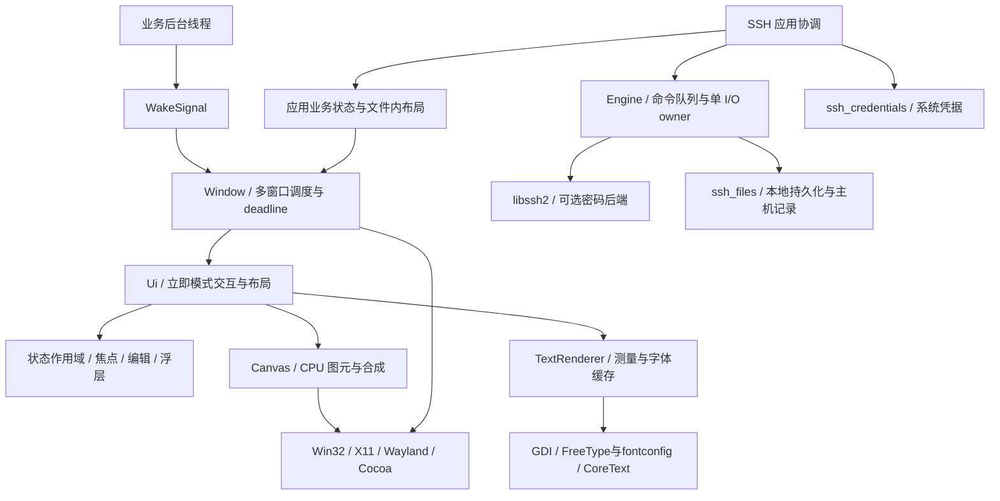

# 全项目工程审查与发展建议（2026-11-23）

审查基线：`fa4b1214efd6e4ce9cc5d600bfc4f0fef447a353`。行号针对该提交，后续以函数名追踪。定位：**单头文件、核心零第三方构建依赖、CPU 光栅化、事件驱动低功耗、macOS 视觉**。

> 本文是修复前基线。后续用户明确要求移除历史接口，覆盖本文“保留兼容入口/自动迁移”的原建议。
> 当前实现、接口迁移表、实际修复范围和发布验证以 [v0.5.4](../releases/v0.5.4.md) 为准；下文保留原始发现与证据，不能作为当前 API 手册。

总体判断：现有架构适合设置工具、连接管理器、小型桌面应用，无须推翻。当前优先级是修正测量与编辑的边界、确保增量构建可信、补齐网络和原生平台验收，再优化长文本交互与资源预算。控件数量、能编译的平台数量与工程成熟度不能相互替代。

## 0. 范围、方法和验证结果

- 基线有 174 个 Git 跟踪文件，其中 C++ 源/头 73 个、Python 24 个；`tools/probe/` 有 61 个 C++ 文件。这些是规模统计，不是覆盖率。检查了目录与构建依赖，重点阅读核心实现、六个示例、三个 SSH 支持头、工作流、测试入口、工具及网站实现；未逐行审计内嵌第三方前端分发文件和系统库。
- 核心 `aino.hpp` 为 17,887 行，SSH 客户端 4,156 行、SSH 核心 3,082 行、函数查看器 2,355 行、Gallery 2,092 行。单文件分发与逻辑模块划分是两件事，不能仅凭文件长度判定架构错误。
- 证据分为：**确定**（源码存在明确错误路径，或本机已观察到）、**风险**（后果依赖输入、资源或时序）、**建议**（未证明有正确性错误）。严重程度与证据强度分别记录。
- 遵循 `AGENTS.md`，此次不是发布验证，**未运行 CTest、回归探针、批量验证脚本、网络传输或性能基准**。没有新的 CPU、延迟、吞吐、内存峰值或跨平台截图结论。
- Windows 使用 MSVC 19.51.36247、Windows SDK 10.0.26100.0、CMake 4.4.0-rc1、Ninja 1.13.2。`build/audit-20261123` 配置 `AINO_BUILD_TESTS=OFF`、`AINO_BUILD_SSH=ON`，六个示例全部 Release 编译/链接成功。SSH 使用本机既有依赖，未重新下载或审计第三方源码。
- `tools/msvc_build.py` 原命令配置失败，改用环境中实际存在的 Ninja 后完成编译；依赖记录暴露了 H03。另在 `build/audit-20261123-en` 设置 `VSLANG=1033` 后单独编译 Gallery，仍未登记头文件依赖。构建日志和依赖输出保留在后一个目录，构建产物均被 Git 忽略。
- 此次仅增加报告及审查索引，不修改运行代码、API、布局、截图或业务数据，也未提交、部署。下述修复是可评审方案，不能解读为已实施。

历史问题已重新核对：CSI 数值饱和、剪切成功后才删除、SFTP 暂存提交、凭据系统保存、SSH 单 I/O owner、有界收发队列、WIC 错误检查、字体重配、帧异常恢复以及 Wayland 后端均已有实现，不再照抄旧报告为未修复项。其运行验收仍应以发布记录为准。

## 1. 项目整体架构分析

### 1.1 职责与依赖

公开声明位于头文件前部，`AINO_IMPLEMENTATION` 后提供实现；`Window::Impl` 持有 `Ui`、画布、文字渲染器、原生状态和唤醒资源。应用持有业务数据，帧回调把数据映射到控件；`Ui::Impl` 保存跨帧交互状态。`Canvas` 负责像素运算，文字后端负责测量和字形，平台后端负责输入、窗口与呈现。`Window::run()` 统一同线程多窗口调度，后台只通过 `wake()/close()` 通知。

SSH 是独立的可选应用，不进入 GUI 核心。认证后的协议操作由 Engine 的一个线程驱动，连接/目录/传输生产者通过命令队列提交，界面读取快照。这比多线程持会话锁执行网络操作更合理；本轮没有把旧的锁内 20 秒等待问题重新当作当前实现。

“零依赖”应准确区分：核心不要求第三方 UI 或图像库的开发包；仍使用系统库。Linux 文字、图片、图标和 Wayland 能力通过动态库实现，运行环境仍需安装相应运行库。SSH、Python 诊断工具、官网渲染依赖和 Figma 资料提取工具各有独立依赖，不能算成核心依赖，也不能无条件删除。

### 1.2 主要优势

1. 单头分发、C++17 和 `aino::aino` INTERFACE 导出兼顾直接拷贝与 CMake 接入，已有跨编译单元链接夹具。
2. 空闲等待、悬停目标过滤、动画限频、光标 deadline 和后台通知已形成完整思路；没有理由改回固定帧率轮询。
3. 圆角、阴影、图标掩膜、文本缓存和函数采样已有专门优化；像素等价与生命周期夹具为继续优化提供基础。
4. 状态拥有者可以区分临时隐藏与永久销毁；示例文件内布局保留独立性，符合仓库约束。
5. Wayland 使用 CPU 缓冲和 `wl_shm`，并限制共享缓冲数量、等待 frame/release；扩平台没有强制引入 GPU。

### 1.3 架构问题与技术债

- **交互契约没有集中落实。** `interact()` 只拦鼠标/命中，已聚焦编辑器继续直接读取原始输入，导致测量和禁用状态漏洞（H01、M01）。应集中检查编辑资格，而不是逐个页面绕开。
- **平台能力与共同 API 不完全一致。** DPI、旋转文字、输入法上下文、同步剪贴板等仍有差异，缺少可查询的能力结果。
- **应用和诊断访问内部实现。** Gallery 使用内部浮层层级、焦点 ID 和画布；SSH 使用原生拖放接收器。它们揭示真实能力缺口，但不应把整个 `Impl` 变为稳定扩展协议。
- **资源预算有多个作用域。** 字体、文本、撤销、图标和后备缓冲各自限额，尚无窗口/进程总量及统一观测。单项有界不等于总量有界。
- **大型示例职责开始拥挤。** SSH 的配置语法、凭据事务、会话、终端和页面集中；Gallery 的清单与枚举区间共同决定分派；函数缓存键依靠位置约定。需要随相关功能修改逐步整理，不能为缩短文件新增通用应用框架。

## 2. 各模块详细审查结果

| 模块 / 实际入口 | 职责、质量与现状 | 主要问题和方向 |
| --- | --- | --- |
| 公开 API、Theme、Style、Stack | 值类型、默认参数和链式配置便于接入；状态/窗口禁止拷贝；存在历史样式字段 | 保留兼容字段；补充能力、失败、透明色哨兵和句柄前置条件说明 |
| `aino.hpp::Canvas`、`raster_*`、`ShadowCache` | CPU 图元与合成集中；不透明快填、掩膜缓存可复用；不直接依赖业务 | 大面积合成受像素和带宽限制；先观测再设计损伤绘制，勿强推多线程 |
| `TextRenderer`、`GdiTextRenderer`、`UnixTextRenderer`、`CoreTextRenderer` | 共同测量接口、字体重配、部分缓存限额已建立 | M05、M09、L02；长文本点击 O(n²)，Unicode/shaping 能力需明确 |
| `WidgetStateTable`、scope、焦点、测量 | 状态归属和显式释放是优点，测量中新建状态可回收 | H01；现存状态仍能被测量路径修改，焦点身份与编辑资格应分开 |
| `Ui::input/textarea/input_otp` | 有选区、撤销、剪切结果、IME 和文本缓存 | H01、M01；单行/多行共享编辑事务可减少规则漂移 |
| 控件、滚动、浮层 | 共用命中与输入闸门，滚动条几何和绘制已集中，有虚拟列表 | 完善键盘遍历；`ScrollScope` 活跃覆盖受限；不要合并掉不同滚动接口 |
| Win32 后端 | 原生输入、IME、DPI、捕获、主题标题栏与阻塞等待最完整 | UTF-16 异常序列策略、背板失败处理、跨 DPI/真实 IME 需发布覆盖 |
| X11 后端 | 客户端字体、XIM、selection/INCR、光标缓存、缩放和呈现均有真实实现 | M09、M13；背板替换应事务化；选区同步等待影响整线程窗口 |
| Wayland 后端 | 动态 ABI、版本绑定、configure/ack、shm、frame、xkb、可选 IME/装饰/DPI | 协议表生成工具有保留许可；真实桌面组合与 IME、拖放需验收；同步读取仍会卡 UI |
| Cocoa 后端 | 主线程检查、NSTextInputClient、Retina、RunLoop 唤醒、等宽缓存已有代码 | M06、M07；原生运行证据不足，不能用 Windows 的 macOS 风格夹具代替 |
| 图片与系统图标 | WIC RAII、解码尺寸检查、RGBA 校验和系统图标缓存已有实现 | M09；Cocoa/GdkPixbuf 分配异常路径仍用裸原生句柄，建议内部 RAII |
| Gallery | 页面/卡片清单、测量缓存、响应式布局、主题与子窗口演示完整 | `body_height()` 复制 App，不能证明公开测量 API 无副作用；分派与内部依赖宜局部收敛 |
| Sidebar / Primitives | 小型、职责直接，可作起步模板；样式留在 `.cpp` | 本轮未发现需独立列级的确定业务错误；不抽跨示例样式文件 |
| Pomodoro | `steady_clock` 管模型，可停止条件变量只负责唤醒，析构先 join | L03；已有 deadline API 可进一步简化，但不为减少一个线程贸然改行为 |
| Function Viewer | Parser→字节码→VM→采样缓存→绘制分段清楚；已有长度/深度/指令限制 | 保留采样缓存；具名化 16 项键，极端浮点和复杂表达式耗时另验，不误报解析深度仍无限 |
| SSH Engine / Terminal | 单 owner、有界命令与字节队列、背压、暂存提交、错误反馈明显改善 | H02、M02、M03、M08；本地磁盘 I/O 仍在 owner 上影响终端延迟 |
| SSH 配置 / 文件 / 凭据 | 配置原子替换、TOFU、DPAPI/Keychain/libsecret，旧记录迁移有保留和回滚 | M04、M05、M10；跨进程并发、断电持久性及 ACL/xattr 仍是明确边界 |
| CMake / 脚本 / CI | 三平台编译、独立 Wayland 构建、发布 CTest、静态运行时检查与导出包 | H03、M11、M12；本机通过不是远端 CI 通过，平台编译不是原生交互验收 |
| 官网 / Wiki / 资料工具 | Markdown 单一来源、请求取消、generation 防串页、白名单路由、HTML 禁用与 DOMPurify 清洗；资料提取工具不进入运行库 | 未发现可确认的站点脚本注入路径；缺少自动浏览器验收和依赖更新闭环，不据此声称绝对安全 |

## 3. 问题清单与严重程度

本轮记录 **3 项 High、13 项 Medium、3 项 Low**。未确认 Critical。High 包含源码缺陷和本机环境触发的构建可靠性问题，不等于确认可远程利用的安全漏洞。建议项不计入缺陷数量。

### 3.1 High

**H01 · 测量模式仍会执行已聚焦编辑器的键盘编辑。确定，静态路径确认。**

定位：`aino.hpp:4538` `Ui::begin_measure()`、`:4601` `detail::interact()`、`:5938` `is_focused()`、`:6668` `Ui::input()`、`:7781` `textarea()`、`:9443` `input_otp()`。

`begin_measure()` 摘画布并标记状态表，但不隔离原始输入/焦点。`interact()` 在测量时提前返回；编辑器随后独立调用 `is_focused()`，仍进入键盘分支。合法调用序列是：编辑器先获得焦点；下一帧有文字/删除键；对同一模型或相同显式 ID 先测量再绘制。测量就能改模型、撤销状态或调用剪贴板，真实绘制可能再次处理同一输入。Gallery 部分测量使用 App 副本，不能推导其所有页面必然重复输入，也不能代替库契约。

影响：使用公开测量 API 的表单和动态布局；可能重复插入、删除或破坏撤销。修复应在编辑命令入口统一要求 `!measure_on`，测量仍登记真实文字/控件范围；同时防止测量改变现存滚动/焦点状态。不要通过不测输入框、清空业务状态或扩大卡片掩盖。发布时扩展 `measure_probe`，覆盖已聚焦、输入、删除、撤销、剪切及测后再画，并检查像素与状态。

**H02 · POSIX 连接等待可能越界写 `fd_set`。确定缺少检查，实际触发属条件风险。**

定位：`examples/ssh_core.hpp:2010` `Engine::wait_sock()`，尤其 `:2021`、`:2022` 的 `FD_SET(fd, ...)`；连接在 `:294` 起创建 socket 后调用此等待路径。

Linux/macOS 的 `fd_set` 是固定容量，socket 描述符大于等于 `FD_SETSIZE` 时 `FD_SET` 不提供安全扩容。代码既未检查范围，也未使用 `poll()`；应用先打开较多文件/连接再启动 SSH 即可进入非法索引路径。Windows 的 fd_set 表示不同，不应把同一数字条件套到 Windows。

影响：POSIX 下高描述符使用进程的栈内存安全。建议 POSIX 分支改为 `poll`，保留可取消等待、错误/挂断处理和绝对 deadline；Windows 保留其 `select` 分支。发布时扩展连接夹具，在隔离进程制造高描述符，结合 ASan/UBSan，勿修改系统全局上限或用户文件。

**H03 · 本机 Ninja 增量构建没有登记头文件依赖。本机已观察，环境相关。**

定位：`tools/msvc_build.py:90` 的环境导出；CMake/MSVC `/showIncludes` 与 Ninja 前缀协作。证据：本轮六个 C++ 对象的 `ninja -t deps` 均为 `#deps 0`，`aino.hpp` 依赖数为 0；`build/audit-20261123/CMakeFiles/rules.ninja` 的 `msvc_deps_prefix` 已乱码，而实际编译输出为中文包含前缀。第二个目录单独构建 Gallery 仍为 0，设置 `VSLANG=1033` 没有解决。

这不是声称所有 CMake/Windows 环境均有此错误，也不能把根因全部归给仓库：本机使用 CMake 预发布版，诊断编码和版本都参与其中。但当前辅助入口未识别此状态；核心单头文件改动后，Ninja 没有依赖边可据此重编对象，可能产出旧代码。

建议固定/记录可用 CMake 与工具链版本，统一诊断语言和编码，并在新配置的发布工程中核对实际头文件依赖；必要时改用工具链支持的其他依赖提取方式。判定标准是对象依赖确实包含 `aino.hpp`，不能只看 Ninja 版本或编译退出码。先在独立构建目录验证，再修辅助入口，不手工修改用户主构建缓存。本轮没有改变源码时间戳来运行增量回归。

### 3.2 Medium

| 编号 / 证据 | 定位、原因及影响 | 建议及验收方向 |
| --- | --- | --- |
| M01 / 确定 | `aino.hpp:6673/6677/6715`、`:7786/7796/7910`、`:9462/9473`：禁用只传给鼠标交互；原有焦点未撤销，键盘分支不检查 enabled。动态设为 `.off()` 后仍可输入、删除、粘贴或撤销 | 定义禁用后的焦点/选区策略，统一阻止修改；保留业务数据。发布时覆盖“聚焦→程序禁用→键盘输入→重新启用” |
| M02 / 确定 | `ssh_core.hpp:2695` 保存 `app_cursor_`，但没有查询/使用；`ssh_client.cpp:1965` 用 `alt_screen()` 选择箭头键序列。DECCKM 与备用屏独立，主屏开启应用光标或备用屏关闭该模式时会发送错误序列 | 增补 Terminal 的模式查询，按模式编码箭头；分别验证主/备用屏 × 应用/普通模式，不能删除备用屏功能 |
| M03 / 确定 | `ssh_core.hpp:2415` 的组合字符分支定义编码 lambda 后 `(void)enc`，只设置 attr 的 0x80 位；Cell 只存单码点，绘制/复制没有消费该标记。`e` 加 U+0301 的音标会丢失，注释却说已追加 | 为非空组合序列设计有界存储及绘制/复制路径，或先准确标注限制。不能单删空 lambda 后宣称 Unicode 已完整；发布时覆盖组合符、宽字符、ZWJ 与复制 |
| M04 / 确定 | `ssh_client.cpp:387` `JsonScan::skip()` 按相同括号计数，不识别字符串和转义；未知字段值中的 `}`/`]` 能提前结束。`:434` loader 在解析失败后仍返回部分结果；`:539` 保存没有“原配置完整”前置条件，后续保存可能覆盖未读条目 | 无依赖地做 token-aware skip，返回解析状态/错误位置；损坏配置保留原文，普通保存不得静默覆盖。先隔离配置事务职责，保留旧密码迁移与导入只读语义 |
| M05 / 确定编码路径不一致 | `aino.hpp:1644` 用窄 `fopen` 读取 UTF-8 font_path；Windows 字体注册走宽 API。中文路径下可能注册成功却读不到家族名。`ssh_files.hpp:306/311` 用窄路径检查/读主机记录，而原子写入采用 `u8path`；`home_dir():56` 的环境路径也未统一转换 | 明确所有应用字符串为 UTF-8，Windows 文件路径在边界统一转宽；从宽环境接口取得目录。覆盖中文用户名、字体目录、主机记录和配置导入；不改现有用户目录位置 |
| M06 / 确定行为差异、契约缺口 | `aino.hpp:16799` `cocoa_sync_geometry()` 总取 backingScaleFactor，未读取 `cfg.high_dpi`；同一配置在 X11/Wayland 可固定栅格为 1，在 Cocoa 无效，字段注释也未说明 macOS 策略 | 明确 macOS 的配置契约并落实，或提供能力/文档说明。须真实 Retina 比较逻辑尺寸、缓冲尺寸和鼠标/IME 坐标；不能仅改变 scale 导致坐标错位 |
| M07 / 确定失败路径 | `aino.hpp:16913/16917`、`:17049/17051`、`:16921/16929`：UTF-8 转 CFString 可返回空，随后无条件 `CFRelease`。无效 UTF-8 标题/图标路径或分配失败可进入非法释放 | 用可判空 RAII，转换失败保留旧标题/回退并反馈错误；检查创建流程资源回滚。属于 Cocoa 路径，未在本机动态复现 |
| M08 / 风险，已有历史边界 | `ssh_core.hpp:283` 同步 `getaddrinfo` 无应用可取消句柄；`ssh_client.cpp:1196` shutdown join 连接线程，`:2725` 退出等待 retired。socket shutdown 不能中断 DNS，慢解析会拖延退出，逐个 shutdown 还可能累加 | 优先向所有会话同时发 stop，再统一回收；异步 DNS 用明确拥有者和期限，不分离捕获 Session 的线程。记录 DNS、磁盘同步和网络取消各自边界，不承诺所有退出均在 2 秒内 |
| M09 / 风险 | `aino.hpp:13553` X11 背板在新资源成功前销毁旧 XImage、调整 vector，失败留下不一致画布；`:16542` Cocoa 背板无像 Wayland 的像素预算。`:6032` 撤销限额按编辑器，`:17840` 图标按条目数，窗口总量未受统一字节预算约束 | 新缓冲成功后一次提交；分配前做受检乘法和平台一致预算；观测每窗口/总缓存。区分可重建缓存与不可丢历史。Cocoa/GdkPixbuf 图片路径补原生句柄 RAII，避免 vector 抛异常时漏释放 |
| M10 / 确定同步调用，延迟属风险 | `ssh_client.cpp:508` 恢复系统凭据、`:587` 保存所有记住密码的 profile、`:609` 清旧凭据，都调用同步系统接口；`:2774` 保存发生在 UI 路径。Keychain/libsecret 解锁或每次全量重存会卡住所有窗口 | 事务在可 join 的工作上下文执行，UI 展示状态；复用未变的凭据引用，仅重存变化项。保留当前“配置提交成功才删除旧凭据”的顺序和失败回滚 |
| M11 / 确定覆盖缺口 | `cmake/Tests.cmake:66` 注册 ssh_ui 默认离线；`example_ui_probe.cpp:483` 的网络场景须 `--local-transfer`；发布 `regression.yml` 没有启动本地 SSH 服务或传该参数。现有发布流程不自动验收新增 owner/取消/暂存协议 | 发布阶段为隔离本地服务器增加有超时的端到端任务，慢网/断线/提交回复丢失另覆盖；日常仍只编译。普通 CTest 通过不能代表网络正确 |
| M12 / 本机已观察 | `tools/msvc_build.py:30/155` 固定 Ninja 为 Python 可执行文件旁的 `ninja.exe`，但 `:139` 版本检查走 PATH。能打印版本仍在配置时因固定路径不存在失败 | 使用 `shutil.which(..., path=env['PATH'])` 的同一结果检查和配置；保留显式路径覆盖和可读报错；CMake 路径也应允许发现。此项独立于 H03 |
| M13 / 确定同步等待 | `aino.hpp:14076` X11 和 `:16293` Wayland 的 `clipboard()` 最多同步等 2 秒；编辑器在帧内调用它，期间只服务有限协议而不正常绘制/响应所有窗口 | 保留同步 API，增补可取消的异步读取/状态结果；粘贴提交前确认焦点/模型仍匹配。超时不可删选区或提交部分内容。2 秒是现有代码期限，不是本轮实测 |

### 3.3 Low

| 编号 / 证据 | 定位与原因 | 建议 |
| --- | --- | --- |
| L01 / 确定局部冗余 | `aino.hpp:3932/4383` focus_consumed 仅定义和重置；`:5956/5964/5966` acc 写入后只 `(void)`；`:1540` 无长度 UTF-8 decoder 在仓库无调用；`tools/regress.py:57/96` want_tail 及期望字符串已不参与判定；`ssh_client.cpp:1960` nav 恒 true | 清局部无读状态、无效参数和过时元数据；内部 helper 先检查下游对 detail 的非契约依赖。`app_cursor_` 属缺失功能状态，不能当无用字段删除 |
| L02 / 确定文档/API能力不符 | `docs/wiki/11-motion.md:151` 把文字旋转写成精确能力；`aino.hpp:3032` 默认 draw_rot 明确忽略角度，只有 GDI 覆盖 | 文档按后端说明，未来补能力查询或实现；不把 GDI 专有能力描述为全平台能力 |
| L03 / 确定尺寸计算 | `examples/pomodoro.cpp:145` 底部区域 y=height-88，卡片高 72，所以距窗底 16，小于 AGENTS 要求至少 22 | 调整卡片和上方内容分配，不减控件和说明。实施时按仓库规范看深浅、默认/最小、DPI 的真实截图并更新相关预览；本轮未改外观 |

## 4. 性能瓶颈与可落地优化

以下预期收益来自算法和调用路径分析，**没有本轮实测百分比**。CPU 渲染是项目定位，GPU 加速不列为默认路线。

| 优先级 / 热点 | 优化原理和预期收益 | 副作用、边界与发布验证 |
| --- | --- | --- |
| P1 长文本鼠标定位：`caret_from_x():5954` | 当前遍历所有前缀，反复编码/测量，冷路径累计 O(n²) 字节与分配。缓存与绘制一致的簇边界/位置，按 x 二分，热定位趋近 O(log n)，重建按文本变化做 | 不能用单字宽简单相加替代 kerning/连字/bidi 的真实布局；验证 1K/10K/100K 字符点击/拖选、位置和分配量 |
| P1 终端滚动：`Terminal::scroll_up():2310`、插删行 | 当前每滚一行复制多行 Cell vector。移动/旋转行容器并清空新行，减少 O(rows×cols) 的重复 Cell 复制；历史保留必要复制 | 宽字符、选区绝对行、备用屏和区域滚动语义需保留；用现有终端夹具和大输出采样检查 |
| P1 本地 I/O 占用 SSH owner：`xfer_step():1235`、`finish_transfer():1834` | owner 执行 fread/fwrite/fflush/fsync，慢盘期间终端协议也等。先测延迟；需要时增加有界双缓冲，由文件生产者处理磁盘，owner 只消费协议块 | 增加内存和退出状态复杂度；保证取消、长度核对、同步后提交和缓冲寿命，不能把字节入队当传输成功 |
| P1 系统凭据保存：M10 | 从每次 O(所有 profile) 次系统操作收敛到 O(变化项)，后台事务防 UI 停顿 | 保留密码修改/撤销记住/迁移/回滚，测试服务被锁、拒绝访问和写配置失败 |
| P1 剪贴板读取：M13 | 将帧内阻塞变为完成事件+window wake，恢复同线程多窗口响应 | 粘贴结果可能晚到，须核对目标身份和版本；不能吞掉或投递给后来聚焦的编辑器 |
| P2 文本缓存：`textarea():7835` | 大文本热帧仍 memcmp 全文，输入/光标路径还会解码。增加可选内容 revision 提示并复用簇索引，未提供提示时保留当前内容校验 | 不破坏直接改 std::string 的现有用法；防“同长度内容变化却缓存命中” |
| P2 状态淘汰：`WidgetStateTable::trim_bytes():3775` | 当前反复全表找最老项，多次淘汰可近 O(k×n)。记录成本并一次选候选或维护简单年龄结构，降低切大页面的峰值 | 小表不值得引入复杂 LRU；避免淘汰本帧仍被引用的条目；先用状态数和耗时证明必要性 |
| P2 全窗清屏/呈现：Canvas、XPutImage、wl_shm memcpy、Cocoa 图像 | 每次完整 4K RGBA 约 31.6 MiB，60 次/秒仅一次全图写入就约 1.85 GiB/s，尚未含混合/拷贝。优先减少无效帧和限制动画；再对稳定页面试验像素损伤区域 | 数值是带宽量级计算，非 CPU 实测。立即模式没有保留命令，首次只减少呈现区域未必减少绘制；阴影、滚动、浮层、alpha 必须合成等价 |
| P2 图标与冷启动：`Ui::system_icon`、`x11_load_system_icon` | 图标线程缓存已存在；Linux worker/磁盘缓存是可选路径，当前示例未调用 worker entry。先分别测首帧、冷缓存和热交互，再决定是否接入 | worker 当前同步等子进程、存在最长约 5 秒等待；不能直接启用来承诺更快。避免每种缺失图标反复启动进程 |

验证口径应固定窗口像素数、DPI、主题、字体、机器、构建选项和 CPU 分母；分别记录空闲、同控件内移动、跨控件移动、拖动、滚动、输入法、动画、多窗口和 SSH 大输出。关注进程 CPU、唤醒次数、p50/p95/p99 输入至呈现延迟、峰值 RSS/GDI/FD、队列水位与丢帧。历史文档中的微秒数不能当成本版本成绩。

GPU 方面当前没有自有 GPU 管线、提交队列或显存分配热点；系统 compositor 的耗用不能冒充本库 GPU 指标。锁方面当前主要应测同步 future 排队、单 owner 本地 I/O、系统服务等待和 X11 同步往返，不能以“增加渲染线程”替代定位。

## 5. 冗余代码与可清理内容

| 内容 | 清理依据 | 处理边界 |
| --- | --- | --- |
| L01 的字段、acc、无效参数与旧期望字符串 | 仓库引用搜索可确认只有写入/传递，无行为读取 | 单独的小清理提交，不改退出码判断，不重写历史诊断程序 |
| `Terminal::put_cp` 未调用的 enc lambda / attr 0x80 | 注释声称实现，但数据未存储、标记无消费 | 与 M03 一起补功能或更正文档，不能删掉所有相关代码隐藏缺失 |
| `line_text/selected_text` 和客户端多份 UTF-8 编码逻辑 | 编码实现重复，容易修一处漏一处；UI 核心另有长度/严格度不同的 decoder | 优先 SSH 内部统一编码；不把不同容错语义强行合为一个函数，不引入通用工具大文件 |
| CI 手写编译与 CMake 链接清单并存 | 多入口维护同一系统库列表，历史已有漂移 | 可逐步复用 CMake；“不带 /utf-8”专门场景、原生专项任务保留 |
| 构建目录和旧二进制 | 已被忽略，属于本机产物 | 本次未删除；不要从 build 中残留目标推断源码还有已废弃示例 |

**不建议删除**：Theme 旧字段、panel/card 等兼容入口；显式与 RAII 滚动接口；文件内重复的示例主题/行布局；X11 字体 fallback；旧密码解码（仍用于迁移）；未注册的 IME/字体/终端复现工具；Wayland 协议表与许可；官网 vendor 及其许可；`docs/macos27/tools` 的开发期依赖。它们都有独立职责，不能用“当前示例没调用”证明公共 API 或诊断代码无用。

代码风格已有 `.editorconfig` 和 `.clang-format`。核心存在紧凑旧段落、巨长行及实现历史注释，降低跟读效率；按修改范围整理命名和 Why 注释即可，不全仓格式化。优先消除错误假设与位置关联，收益高于单纯缩短行数。

## 6. 功能完整性、API 与测试体系

### 6.1 已实现但尚不完善

- 编辑：修 H01/M01 后统一编辑命令资格、焦点、撤销事务；测量只输出尺寸。布局测量和实际绘制边界都应验证。
- 终端：修 DECCKM 与组合字符；当前缩放明确截断而不 reflow，整目录传输、断点续传、SSH agent 尚未提供。不要把有限 VT/xterm 子集描述为完整终端兼容。
- 平台：Cocoa 的 IME surrounding text/选区能力有限；Wayland 文档已明确没有上下文删除、预编辑内部选区和触屏。它们是能力边界，不一律升格为崩溃缺陷。
- 原生系统交互：通用键盘遍历、按钮键盘激活、系统无障碍桥接仍缺；旋转文字跨平台不一致。优先补桌面工具的基本可操作性。

### 6.2 API、生命周期与错误处理

`try_set_clipboard()`、`request_frame_in()`、state scope、快照和不可拷贝资源对象是应保留的方向。继续以**增补**能力/status/snapshot API 的方式演进，旧入口可委托新实现，不随意改签名。

`ScrollScope::operator=(ScrollScope&&):690` 不收尾活跃目标，注释已明确禁止覆盖活跃句柄，因此应归为**受限契约和易误用风险**，不能直接说正常 RAII 用法必然泄漏。简单加 `close()` 遇到嵌套顺序也不安全。建议先在调试版检查活跃覆盖和 LIFO，另行设计兼容的空目标转移规则；禁止凭“RAII 通常这样写”修改当前行为。

`Style` 使用透明色作为未设置哨兵，无法表达部分显式透明覆盖；链式返回引用容易绑定临时引用。这些应说明限制，若扩展则加设置标志，不重新解释旧字段。`Ui::Impl*` 虽公开可访问，也不应承诺内部字段稳定。

`Engine::transfer()/cwd()/fingerprint()` 引用查询、`set_wake()` 的调用时序需明确。当前客户端已有快照和生产者关闭顺序，不能由接口有风险就断言现有代码一定竞态。未来增补不可变传输进度与错误类别，再逐步减少外部依赖内部指针。

异常恢复已有 frame ScopeExit，不能再报“所有帧异常均不恢复”。但原生创建/图片/图标中的裸句柄和失败路径尚未统一，宜逐平台补内部 RAII。应用线程必须先退出再销毁窗口；SSH 正常退出路径已有等待，不把其 detached retire 单凭写法判为必然 use-after-free。重点是 DNS 等等待是否能完成，以及异常退出能否保持同一关闭契约。

### 6.3 测试体系评价

现有夹具覆盖链接、状态寿命、唤醒、内存预算、像素合成、输入编辑、浮层、捕获、布局、示例和文档片段，优于只做窗口 smoke。CTest 隔离输出目录、timeout、native/headless 标签也有价值。仓库规则是发布运行回归、日常编译；`build.yml` 和 release/manual 测试入口总体已按此分开。

| 层次 | 当前覆盖 | 主要缺口 / 发布动作 |
| --- | --- | --- |
| 单元/算法 | 栅格等价、布局、终端、状态、预算 | H01/M01 的状态转换、畸形 UTF-8、极端尺寸、组合字符；扩展既有夹具 |
| 集成 | 原生 smoke/pixels/wake、部分 GUI/SSH 离线 | M11；外部消费项目 install/export、多编译单元和 H03 依赖提取需列为发行工程检查 |
| 原生输入/桌面 | Windows 历史较充分；Wayland 有 Weston 发布任务 | GNOME/KDE/wlroots、真实 macOS、系统 IME、跨应用剪贴板、混合 DPI、休眠恢复 |
| 压力/并发 | 有状态/队列预算与 wake 夹具 | 长时间多会话/窗口开关、队列满、慢盘、DNS、反复重连、提交回复丢失、退出 |
| 安全/边界 | 有路径和凭据及终端极值夹具 | 发布阶段增加 sanitizer；为 Terminal、JsonScan、公式编译做独立有界 fuzz harness，不能只统计探针数量 |
| 性能 | Windows 交互采样、分项日志、benchmark 工具 | 跨平台同口径延迟与唤醒；`gallery_bench` 的样本计数断言不是 CPU/延迟性能门槛 |
| 官网/工具 | 有历史人工验证与依赖版本/哈希说明 | 发布时校验 Markdown 链接、路由/超时/脚本过滤、窄屏键盘访问，复核上游依赖公告 |

没有代码覆盖率、压力稳定时长或 sanitizer 的本轮数据，因此不打“覆盖率 90%”或“无内存泄漏”之类分数。SSH 密码库与前端依赖未做完整 CVE 审计；版本固定和校验和是已有措施，还需要维护升级节奏。

## 7. 推荐重构方案及影响

| 方案 | What / How / Why | 兼容边界与风险 |
| --- | --- | --- |
| 编辑事务内部内核 | 把编辑资格、选区约束、命令与撤销统一；input/textarea 保留各自布局和坐标映射。首先解决 H01/M01 | 保留公开函数和返回语义，避免把单行过滤规则套到多行；先明确测量/禁用策略再实施 |
| 平台内部契约清单 | 统一创建失败、DPI、输入、剪贴板、关闭、deadline 的结果约定；小型原生资源 RAII | 仍分发一个头文件，不引入虚接口层层转发；先补失败路径，再增 capability API |
| SSH 配置事务隔离 | 将解析/验证/序列化/迁移结果形成独立职责，凭据提交与回滚围绕明确结果执行 | 样式仍在 `ssh_client.cpp`；保留旧记录、只读导入、错误提示；不引入强制 JSON 依赖 |
| 终端模式与文本单元 | 明确模式查询、输入编码、字符簇与复制之间的边界，先补 DECCKM 再补组合存储 | 不替换整个终端，不把普通光标模式绑定到备用屏；重流作为独立可选功能 |
| 缓存与观测 | 具名键、累计字节、高水位与命中率；修正预算空白，再谈复杂淘汰结构 | 不清空全部状态来“省内存”；历史内容和可重建缓存不同；维持帧内引用寿命 |
| 工程入口收敛 | 修 Ninja 发现与依赖提取；正式构建/发布优先 CMake；保留专项直接编译用例 | 不强制所有用户使用 CMake，不影响直接拷贝头文件；工具链验证先用独立构建目录 |

这些是分批方案，不建议一次提交完成。尤其 SSH I/O 双缓冲、跨平台文字布局、无障碍和损伤绘制须先有小设计、预算与验收表，再实现。

## 8. 分阶段优化路线图

| 阶段 / 顺序 | 工作内容 | 预期结果与完成条件 |
| --- | --- | --- |
| P0-A 正确性 | H01、M01；随后 H02、M04 | 测量/禁用不改模型，连接无 fd_set 越界，配置不会因部分解析被普通保存覆盖；受影响目标编译，相关夹具留发布验收 |
| P0-B 构建可信 | M12→H03，记录工具链与依赖 | 新目录可发现真实 Ninja；对象登记头依赖，发布时确认改头触发重编；不能以 clean build 代替增量正确性 |
| P1-A 实用兼容 | M02/M03/M05/M06/M07 | 终端模式与基础 Unicode 正确，中文路径一致，Cocoa 配置和失败路径可解释；原生平台确认 |
| P1-B 发布验收 | M11；慢网/断线/取消/提交不确定、DNS退出、凭据服务场景 | 将“已实现待验收”转为有记录的发行证据；明确失败项和不支持能力，不静默跳过 |
| P1-C 响应与预算 | M08/M09/M10/M13，优先 O(n²) 光标定位 | 大文本与系统服务不长时间卡帧，资源有可观测预算，退出边界明确；发布时记录 p95/p99 和水位 |
| P2 可维护/API | 编辑内核、配置职责、具名缓存键、capabilities/status、通用键盘导航 | 降低示例对内部实现依赖，保留旧 API，使用文档和示例可直接接入 |
| P3 中长期 | 有界语义树/无障碍、跨平台 shaping、可选损伤渲染 | 每项有真实用户场景与性能/兼容证据，再决定进入默认核心；不按日历堆功能 |

每阶段分别形成问题定位、最小变更、编译、差异复查；UI 变更依仓库要求看深浅/最小/DPI 实际截图并更新引用图片。回归、端到端、压力与性能任务放在发布验收执行。没有测量证据的优化不得以“降低 50% CPU”等数字作为完成说明。

## 9. 项目发展建议与创新功能推荐

### 9.1 同类项目中可借鉴的设计

本轮读取了以下上游 README/FAQ 作为设计参考；没有做这些项目的源码审计、版本稳定性或性能横评。

| 参照 | 值得借鉴 | 对 aino 的取舍 |
| --- | --- | --- |
| [Dear ImGui FAQ](https://github.com/ocornut/imgui/blob/master/docs/FAQ.md) | 稳定 ID、输入捕获归属、集成边界的详细契约；结合列表裁剪思想 | 完善既有 scope/输入模型和诊断，不引入其默认视觉或要求 GPU |
| [Nuklear](https://github.com/Immediate-Mode-UI/Nuklear) | 单头、无依赖，明确 UI 与宿主输入/渲染边界 | 学习契约清晰与按需接入；aino 自带原生后端是价值，不为了相似而全部剥离 |
| [LVGL](https://github.com/lvgl/lvgl) | 软件渲染、缓冲预算、多种输入设备与受限资源设计 | 借鉴资源/局部更新与事件组织；不改成嵌入式保留模式框架，不增加默认运行依赖 |
| [AccessKit](https://github.com/AccessKit/accesskit) | 自绘 UI 的语义树、增量更新、平台适配分离，对立即模式也有明确适用思路 | 借鉴数据模型；其适配器主要为 Rust，不作为零依赖 C++ 核心的强制依赖，可先研究可选外部适配 |

与项目最相关的方向是低功耗、确定的资源预算、原生 Wayland/混合 DPI、无障碍和复杂文本。无需追随 GPU 特效、插件市场或云服务来证明创新。

### 9.2 短期可落地

| 建议 / 优先级 | 理由、解决的问题与实现思路 | 难度 / 预期收益 |
| --- | --- | --- |
| **只读能力与失败结果 P1** | `BackendCapabilities` 描述 IME、旋转文字、拖放、缩放等；同步/异步系统操作返回明确 status。避免 API 名称相同却静默降级；旧函数委托新接口 | 中；提升跨平台接入可信度，文档矩阵可与实际能力对应 |
| **资源与帧诊断快照 P1** | 在现有 AINO_PROF/日志上增补每帧原因、缓存字节、队列水位、deadline、状态数；默认关闭，应用可读取快照 | 低至中；“空闲 0% / 交互极低 CPU”可追踪，减少凭截图猜性能 |
| **编辑布局缓存与 revision 提示 P1–P2** | 修 O(n²) 定位，并为高级使用者提供可选内容版本；默认字符串 API 行为保留 | 中；长文本点击/拖选更顺畅，降低复制与分配；须与真正字形布局一致 |
| **最小消费项目与兼容样例 P1** | 分别展示单 TU、分离实现 TU、install/export 和后台 wake；发行时编译这些明确用法 | 低；降低第一次接入成本，防声明/实现/链接参数漂移，不额外发明应用模板系统 |

### 9.3 中期产品能力

| 建议 / 优先级 | 理由与实现思路 | 难度 / 预期收益 |
| --- | --- | --- |
| **通用键盘导航 P2** | 工具窗口应可不用鼠标操作。按稳定 ID 记录可见、enabled、焦点顺序与语义动作，处理 Tab/Shift-Tab/Enter/Space；浮层与虚拟列表明确归属 | 中；直接改善可操作性，也是无障碍前置条件；不引入完整控件对象树 |
| **异步桌面操作 P2** | 剪贴板、凭据、文件选择可能等待系统。用请求句柄、完成事件、取消和身份/版本校验，与既有 wake/deadline 调度配合 | 中；避免同线程全部窗口冻结。无需新增通用线程池或对所有 API 强制 async |
| **公开的轻量拖放 P2** | SSH 已在 Windows/Wayland 访问内部接收器，有真实复用需求。先提供文件 URI/路径的 typed receiver、可接受区域、动作和生命周期契约，再补平台适配 | 中；业务应用免接触 native/Impl；须说明未支持的平台，不保证同步完成上传 |
| **可选语义节点 P2** | 稳定 ID 输出 role/name/value/state/actions 和几何，只发送变化；先验证 UIA/AX/AT-SPI 一个小控件集 | 高；让读屏、辅助输入和自动化理解自绘控件；保护密码，不要求每帧保留完整 UI 树 |
| **可靠 SSH 示例增强 P2** | 先补现有终端、凭据和实传验收，再按需求加 agent 认证、可控递归传输/冲突策略 | 中至高；提供可信的真实应用参考。与 GUI 核心隔离，续传需独立源一致性设计 |

### 9.4 长期研究

| 建议 / 优先级 | 理由与实现思路 | 难度 / 预期收益 / 决策门槛 |
| --- | --- | --- |
| **字形布局/字符簇的一致层 P3** | 多语言编辑需要测量、换行、光标、选区与绘制共用布局结果。先约束接口，再用平台 shaping；Linux 可研究可选运行时适配 | 高；改善连字、组合符、双向文字和 emoji。核心不能因此强制外部构建依赖；先公布能力边界 |
| **CPU 损伤区域与静态层缓存 P3** | 对大型窗口中局部变化减少带宽；从实际像素损伤及稳定层开始，与已有效果缓存协作 | 高；收益随损伤面积变化，无统一 CPU 百分比。需像素等价、状态寿命、脏区膨胀和内存预算证据 |
| **受控 headless 宿主接口 P3** | 现有探针大量访问内部 Canvas，可提炼最小离屏输入/画布宿主契约，用于文档渲染和跨平台验证 | 中至高；减少内部测试耦合，支持可重复输出。先确认真实使用需求，不建立网络远程桌面框架 |

不推荐当前优先投入：GPU/Vulkan 重写、通用插件系统、跨示例公共样式框架、全面换语言、强制包管理、浏览器/WASM 和 Android 同步扩张。先让现有桌面平台、编辑、网络和工程入口可验证，才能支撑后续扩展。

## 10. 交付与未完成边界

本轮交付为当前提交的源码证据、分级清单、模块评价、性能方案、保守清理依据、API/测试评估和路线图。六个 Windows 示例编译通过；同时发现工具入口失败与本机依赖提取错误，已如实保留。Linux/macOS/Wayland 未在本轮原生编译或运行，网络正确性、性能收益和安全风险的动态后果仍待对应发布验收。

后续实施应按 P0 顺序拆成独立变更，并关联本报告编号。报告中的方案不意味着可以无审查地改 API、业务数据、平台契约或整套架构。
