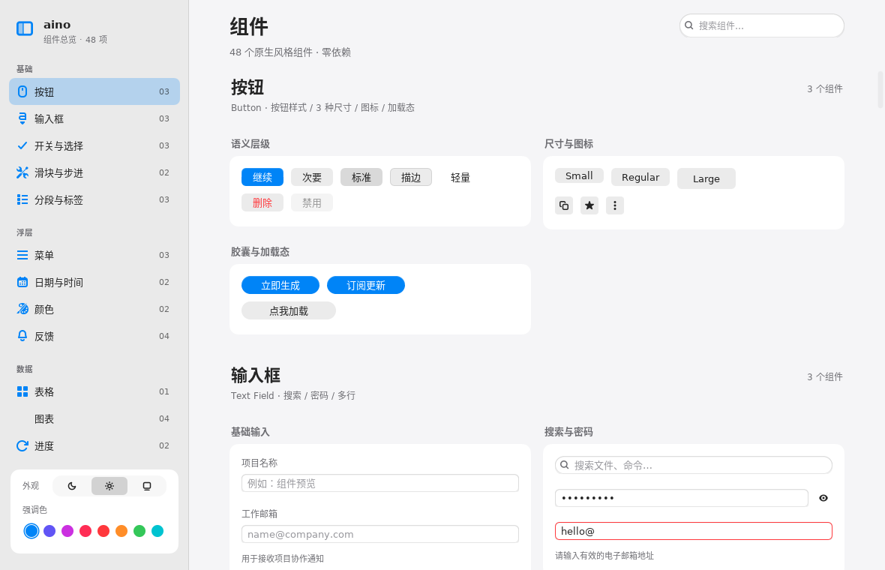

# 15 · 原生 Wayland

Linux 可以直接连接 Wayland compositor，通过 `wl_shm` 呈现 CPU 像素，不需要 X Server、
XWayland、EGL 或 GPU。控件、字体缓存及按需绘制与其他后端共用。



## 构建与运行

```sh
cmake -S . -B build/wayland -DAINO_WAYLAND=ON
cmake --build build/wayland --parallel 2
env -u DISPLAY ./build/wayland/aino_gallery
```

手工编译时，在所有包含 aino 的编译单元使用相同的后端选项：

```sh
g++ -std=c++17 -O2 -DAINO_WAYLAND main.cpp -ldl -pthread -o app
```

不需要 Wayland、xkbcommon、FreeType 的开发头文件，也不需要 `wayland-scanner`。
协议 ABI 已包含在 `aino.hpp`；运行时通过 `dlopen` 加载系统库。
默认构建仍为 X11。两个后端分别构建，不会在连接失败时偷偷启动 XWayland。
使用导出的 CMake 包时，`aino::aino` 会传播该安装包选定的后端与链接参数。

桌面运行时需要 `libwayland-client.so.0`（1.20+）、`libxkbcommon.so.0`、
FreeType 和 fontconfig；鼠标主题使用 `libwayland-cursor.so.0`。
Linux 图片和主题图标仍使用 GdkPixbuf，与 X11 路径一致。Ubuntu 可安装：

```sh
sudo apt install libwayland-client0 libwayland-cursor0 libxkbcommon0 \
    libfreetype6 libfontconfig1 libgdk-pixbuf-2.0-0 fonts-noto-cjk
```

中文需要覆盖中文字形的字体。`fc-match :lang=zh-cn` 应匹配 Noto CJK 等中文字体；
只匹配 DejaVu Sans 通常表示未安装 CJK 字体。安装后重启应用以重建回退链。
缺字时显示字体的缺字标记，并向 stderr 报告一次，不静默隐藏文字。

SSH 示例额外使用 `-DAINO_BUILD_SSH=ON`，并安装 libssh2 开发库。
`WAYLAND_DISPLAY` 和 `XDG_RUNTIME_DIR` 必须指向当前桌面会话；通过 SSH 登录的纯终端通常没有该会话。
连接失败或必要运行库缺失时 `Window::ok()` 返回 false，并向 stderr 写出原因。

## 窗口、缩放与调度

窗口通过稳定版 xdg-shell 创建。支持标题、内容尺寸、最小/最大尺寸、关闭与多窗口；
优先请求 compositor 的服务端装饰。没有服务端装饰时使用库内标题栏，提供关闭、最小化、
最大化、拖动和边缘缩放。窗口居中、实际位置与最终尺寸由 compositor 决定，
`WindowConfig::center` 不会绕过 Wayland 的窗口定位限制。

`Window::width()/height()` 和控件坐标描述内容区，不包含库内标题栏。
`set_size()` 请求内容尺寸，compositor 在平铺、最大化等状态下可覆盖该请求。
`render()` 同步执行绘制回调；若上屏暂不可用，会保留最新画面，在后续 `poll()` 中呈现。
使用自定义主循环时须持续服务 `poll()`；普通程序使用 `run()` 即可。

整数缩放来自 surface 所在的输出。compositor 同时提供 fractional-scale-v1 和 viewporter 时，
使用首选分数缩放，否则采用整数缩放。`high_dpi=false` 将栅格倍率固定为 1；
compositor 仍可按桌面策略缩放窗口。

共享内存缓冲最多保留三个，只有收到 `wl_buffer.release` 才会复用。
调整尺寸时只替换已释放的缓冲；单个表面限制为 16,384 边长、约 1,677 万像素。
没有输入、动画或待处理任务时，事件循环阻塞等待 Wayland 连接与后台唤醒管道。
frame callback 控制呈现节奏，等待 compositor 时不忙等；按键重复也纳入下一截止时间。

## 输入与剪贴板

键盘使用 compositor 发来的 xkb keymap，支持布局、修饰键、Compose/死键及系统重复速率。
失焦或设备移除时清理按住状态。鼠标支持按钮、双击、拖动、垂直滚轮/触控板滚动与主题光标。

compositor 提供 text-input-v3 时，输入框发送光标矩形、密码/多行用途，接收预编辑与提交。
密码框标记为 hidden/sensitive；库不向输入法发送密码正文。
没有 v3 协议时仍能使用 xkb 文本与 Compose，但不承诺系统 CJK 输入法可用。
目前未提供 surrounding-text、上下文删除、预编辑内部选区或触屏输入。

剪贴板通过 `wl_data_device` 交换 UTF-8 文本，保留 `clipboard()` / `try_set_clipboard()` API。
系统要求有效的输入 serial 和键盘焦点；没有权限时写入返回 false，调用方不能据此删除原选区。
接收与发送都有 32 MiB 大小上限及 2 秒期限，超时/断管不会提交部分粘贴数据。
读取期间也会服务同线程其他窗口的选区请求，防止同进程复制粘贴互相等待。
为限制未完成请求，最多保留八个剪贴板 source 和八条发送流；达到上限时拒绝新请求。
后台发送不会阻塞 UI，应用退出后的剪贴板保留取决于桌面剪贴板管理器。
尚无拖放 API，收到拖放 offer 时明确拒绝。

## 桌面标识与图标

Wayland 使用 app-id 匹配 `.desktop` 文件，而非 X11 的 `_NET_WM_ICON`：

```cpp
aino::WindowConfig config;
config.title = "My Tool";
config.app_id = "org.example.MyTool";
aino::Window window(config);
```

安装 `org.example.MyTool.desktop`，并让 `Icon` 指向已安装的主题图标：

```ini
[Desktop Entry]
Type=Application
Name=My Tool
Exec=/opt/mytool/mytool
Icon=org.example.MyTool
Terminal=false
```

`app_id` 在其他后端忽略；`icon_path` 不会在 Wayland 下自动安装桌面文件或主题图标。

## 维护与验收

协议表由 `tools/generate_wayland_protocols.py` 从系统的 Wayland / wayland-protocols XML 生成，
保留协议许可。只有更新协议 ABI 时才运行此脚本；普通构建不依赖 Python 或 XML。
新协议是否可用由 registry 和绑定版本决定，不能仅根据系统库版本推断。

排障可使用 `WAYLAND_DEBUG=1` 查看协议，`AINO_WAYLAND_TRACE=1` 查看字体路径。
检查纯 Wayland 时清除 `DISPLAY`，并用 `ldd` 确认应用未链接 libX11。
日常 CI 单独编译 Wayland 的六个示例；这不能替代真实 GNOME/KDE/wlroots 桌面、
CJK 输入法、跨应用剪贴板及混合 DPI 多屏验收。平台边界见[能力矩阵](14-platform-status.md)。
